# whimsy-ui

Thirty-four small, tactile SwiftUI components, each with a pure-Swift, unit-tested core:

| | Component | What it does |
|---|---|---|
| 🫧 | **PopTherapy** | Bubble wrap: drag to pop, per-bubble squish, haptics, a gloss shader, and a gift when you finish. |
| 🧲 | **MagneticBeadSlider** | A slider whose beads trail the thumb like a magnetic chain, with squash, snapping and haptics. |
| 🩹 | **EraserDelete** | Delete a card by rubbing it out with a zig-zagging pink eraser, with crumbs. Automatic or manual scrub. |
| 📷 | **ShutterReveal** | A camera-iris reveal: metallic blades swirl open with overshoot and snap shut. |
| 👀 | **AliveEyes** | Two cartoon eyes with a spring gaze, saccades, asymmetric blinks and a shake-triggered squint. |
| 🧩 | **ScatterRegroup** | Tap a tile grid: tiles fling out tilted, then spring home in a ripple from the centre, ticking as they land. |
| ☀️ | **SolarFlareLike** | A like button: the heart pulses while curved, tapering flare ribbons erupt in a swirl. |
| 🚀 | **FlyingButton** | A capsule button that takes off when held: thrust plume, hover bob, shrinking shadow, soft landing. |
| 🎞️ | **GrainyRingGallery** | Photo cards on a 3D ring: drag with momentum and snap, depth blur, a hero detail view, and 12 fps Metal film grain. |
| 🧭 | **LiquidMetalCompass** | A liquid-chrome blob that leans and stretches toward a friend, wobbling on springs as you turn, with a dead-on haptic tick. |
| 🧶 | **SweaterRail** | A clothes rail that magnifies like the macOS Dock: garments spread, swell and swing on pendulums; tap one for a matched-geometry hero page, with a marquee ticker. |
| 🔤 | **FontCollection** | A font specimen gallery: a split-flap headline flips through 16 built-in faces and settles, category chips make the cards hop and regroup, and each card opens into a detail view. |
| 🫠 | **FollowBlobHero** | A landing-page hero whose blurred mesh-gradient blob chases your finger on a delayed two-stage spring, squashing and stretching along its velocity, with palette chips. |
| 🌗 | **MoonPhaseScrubber** | An Animatable moon whose terminator is a half-ellipse of x-radius r·cos(2πp): drag sideways to scrub, release to spring-snap to the nearest of eight named phases with a soft haptic, plus earthshine near new moon. |
| 🧵 | **ClothPoster** | A poster card that ripples like hanging cloth: a Metal distortionEffect sends waves out from your finger, a colorEffect adds sheen on the crests, release rings down on a damped spring, and a light haptic ticks per crest. |
| 🖼️ | **TiltPhotoGrid** | A kinetic-typography intro of heavy black italic words cutting through three phrases, then a masonry grid of generated portraits that tilts and pans as one 3D plane away from your finger (or device motion), with per-card parallax. |
| ⌚ | **ScrollSpinWatch** | A dark technical page where a smartwatch built from layered shapes turns front → side → back → front as you scroll, with copy that fades and slides in sync and a numericText stats row at the end. |
| 🛍️ | **BoutiqueBurst** | A large serif "Boutique" with a few paper-doll cutouts; a tap fills the screen with dozens of figures in a staggered spring ripple, and tapping one keeps it while the rest slide away before it becomes the hero of a detail view. |
| 🏷️ | **PeelableSticker** | An emoji sticker on a card that peels back from any corner along your finger, with a reflected flap showing its lighter back and a soft shadow at the fold; let go early and it springs flat, past halfway it pops off and tumbles away, and a fast yank tears it in two. |
| ❄️ | **FrostCard** | A card that frosts over while you hold it: seeded ice crystals branch in from the edges at 60° as fractal line segments, then melt back in reverse with a soft blur and little droplets sliding down when you let go. |
| 🌈 | **HoloFoilCard** | A holographic trading card you drag to tilt (soft-clamped to ±15°). A Metal colorEffect sweeps a rainbow diffraction band across it with the tilt, and sparkles light only inside their own angle windows. It springs back with a wobble and ticks a light haptic each time the band crosses the centre. |
| 🎨 | **OilPaintRestore** | A faded, blurred photo you restore by painting over it. Strokes get thinner the faster you drag, and wet paint smears slightly along the stroke and catches an impasto highlight from a Metal layerEffect. Each stroke dries matte over about 2 s, a light haptic ticks every few strokes, and "Restore all" brings the whole picture back. |
| 〰️ | **WiggleMatchSearch** | A settings search with fuzzy subsequence matching that ranks word starts and consecutive runs highest. Every matched letter gets its own little sine-wave underline, and newly matched letters jiggle in on a spring with a light haptic. Half a second after you stop typing, the waves calm to a flat line. |
| 🫗 | **PourOpenMenu** | A "Sort: Newest" pill that melts downward into a four-option menu of metaball drops (blur plus alpha threshold in a Canvas). The options drip out one after another, stretch into thin necks and pinch off. Picking one crossfades the label and pours everything back up, with a lift shadow and a soft haptic on landing. |
| 🐙 | **OctoDoneChecklist** | A five-row to-do list. Tick a row and the checkmark draws in, a blurred halftone blob swells up from below, a dotted tentacle curls over the row, and ink and row are pulled down together with a volume-preserving squash and stretch before the row collapses and the rows below spring up. Complete all sweeps the ink through every remaining row, and Reset brings them back. |
| 🎵 | **AsciiNowPlaying** | A now-playing card whose album art is drawn entirely in text. A generated cover is boxed down to 48 columns, mapped from luminance to a ten-glyph ramp and drawn in tinted monospaced glyphs that shimmer slowly. Tap and the glyphs scramble outward from your finger, then settle back cell by cell with a light haptic. Drag up or down and the art resamples between crunchy (24 columns) and fine (72). |
| 💌 | **DogEarPeelCard** | A Halloween invitation whose bottom-right corner folds back as you drag, with true paper geometry: the crease is the perpendicular bisector of corner and finger, the lifted part is mirrored across it as a shaded paper back, and a soft shadow falls on the card. Let go early and the corner springs flat with a small bounce. Past 60% the fold sweeps across and the card flies away, revealing a hidden note. Reset puts it back. |
| 🍬 | **ColorFigureGumball** | A hand-inked isometric gumball machine in generated shapes. Drag it to turn a full 360° with inertia, insert a coin, turn the crank and a gumball drops out of the flap. See-through shows the coin mech, pocket wheel, spring and chute with labelled parts, and swatches and a wobble slider restyle the ink. Inspired by Colorfigures by April Zhu (MIT). |
| 📺 | **ChannelFlipCard** | A photo card that flips pictures like an old CRT TV changing channel. Tap and the photo tears sideways in horizontal bands over five discrete frames, red and blue split, static crackles and it flashes white at the moment the photo swaps. Swipe for next or previous: a slow swipe is mild and short, a fast flick up to twice as long and much stronger. A green channel number fades in and out. Six generated photos, or pass your own images. |
| 🗺️ | **ContourInkLoader** | A loader that sketches a topographic map with a pen. Seven wobbly contour rings are drawn one after another on cream paper in sepia ink, every third one thicker, and they never cross. When the last ring closes a red dot climbs a switchback route to the peak and leaves a dashed trail, then the sheet tilts back 25°, fades and the loop starts again. A light haptic ticks as each ring closes. Reduce Motion shows the finished map with the dot at the peak. |
| 📚 | **ShelfPull** | A wooden shelf of seven book spines. Drag one up against a rubber band while its neighbours lean into the gap. Pull past the commit distance, or flick, and it lifts free, turns 90° to show its cover and opens into a card with a small live demo. Tap outside and it turns back and slides home with a soft thunk. Let go early and it springs back. Reduce Motion crossfades to the card without the 3D turn. |
| ✨ | **StarJar** | A glass jar of about forty stars asleep in a dim heap. Tap it and they brighten, twinkle on their own rhythms and float up to drift like fireflies; drag inside to stir them, with a soft tick when one brushes the glass. While it is awake the page stops scrolling. Tap outside and they settle back down and dim. Reduce Motion gives a steady glow with no wander. |
| 🎯 | **HoldToFanDock** | A floating action button that fans four tabs out along a quarter-circle when you press and hold. Drag toward a tab to highlight it, lift to select, or drag off the arc to cancel. A short tap never arms. Reduce Motion snaps open and closed. |
| 💨 | **VelocityGlyphScatter** | A price slider from $40 to $600 in $5 steps. The price is one glyph per character; while you drag, each one takes a seeded vertical offset and a lean of a few degrees scaled by thumb speed, then springs home with a small overshoot. A light tick marks every step, and a fast drag blurs the glyphs. |

iOS 17+ / macOS 14+, Swift tools 6.0 (Swift 6 language mode).

> **Honest status:** every core target builds, and all 1264 tests pass on Linux (Swift 6.4.2).
> The SwiftUI targets have **not yet been compiled or run on an Apple platform**. On Linux
> they compile to empty modules (`#if canImport(SwiftUI)`). They were checked with
> sourcekit-lsp (0 diagnostics), `swiftc -parse` and careful API review, but expect
> possible small fixes on the first Xcode build.
> The GIFs below are **HTML5 Canvas ports** of each view's drawing, running a JS port of
> the same core logic. They approximate the SwiftUI rendering; they are not device
> recordings. The FontCollection GIF also substitutes look-alike web fonts (e.g. Playfair
> Display for Didot, Libre Baskerville for Baskerville) for Apple's built-in families.

## Install (Swift Package Manager)

In Xcode: **File ▸ Add Package Dependencies…**, enter this repository's URL, and add the
products you want. Or in `Package.swift`:

```swift
dependencies: [
    .package(url: "https://github.com/<you>/whimsy-ui.git", from: "0.1.0"),
],
targets: [
    .target(name: "MyApp", dependencies: [
        .product(name: "ShutterReveal", package: "whimsy-ui"),
        .product(name: "AliveEyes", package: "whimsy-ui"),
    ]),
]
```

Each component is its own product: `PopTherapy`, `MagneticBeadSlider`, `EraserDelete`,
`ShutterReveal`, `AliveEyes`, `ScatterRegroup`, `SolarFlareLike`, `FlyingButton`, `GrainyRingGallery`, `LiquidMetalCompass`, `SweaterRail`, `FontCollection`, `FollowBlobHero`, `MoonPhaseScrubber`, `ClothPoster`, `TiltPhotoGrid`, `ScrollSpinWatch`, `BoutiqueBurst`, `PeelableSticker`, `FrostCard`, `HoloFoilCard`, `OilPaintRestore`, `WiggleMatchSearch`, `PourOpenMenu`, `OctoDoneChecklist`, `AsciiNowPlaying`, `DogEarPeelCard`, `ColorFigureGumball`, `ChannelFlipCard`, `ContourInkLoader`, `ShelfPull`, `StarJar`, `HoldToFanDock` and `VelocityGlyphScatter`. There's also a SwiftUI-free `…Core` product for each
(e.g. `ShutterRevealCore`), plus `WhimsyGallery`, a demo list of all thirty-four.

```swift
import WhimsyGallery
WhimsyGallery()   // NavigationStack listing every component with a live demo
```

---

### 🫧 PopTherapy


```swift
import PopTherapy

PopTherapyView()                    // 6 × 8 sheet
PopTherapyView(columns: 5, rows: 7)
```

- **Popping:** drag to pop. Fast drags interpolate, so no bubble is skipped.
- **Feel:** each pop squishes and gives a light haptic of random intensity. A Metal
  `.colorEffect` shader drifts a gloss highlight across the sheet.
- **Finish:** popping everything unwraps a gift, with a Reset button.

### 🧲 MagneticBeadSlider


```swift
import MagneticBeadSlider

@State private var value = 0.4
MagneticBeadSlider(value: $value, steps: 10)   // stepped; snaps on release
MagneticBeadSlider(value: $value, steps: 0)    // continuous
```

- **Motion:** eight beads follow the thumb with distance-falloff pull and per-bead damped
  springs, squashing along their motion.
- **Haptics:** selection feedback on step crossings, and an impact on snap.

### 🩹 EraserDelete


```swift
import EraserDelete

NoteCard(note)
    .eraserDelete(isErasing: $isErasing) {
        withAnimation { notes.removeAll { $0.id == note.id } }
    }
// or ErasableCard(isErasing:style: .manual, onErased:) { … } to scrub by hand
```

- **Masking:** the card is masked by the growing stroke (`.destinationOut`).
- **Feel:** a haptic on each zig-zag turn, and crumbs fall off the eraser.
- **Finish:** at 96% coverage the remains fade and `onErased` fires.

### 📷 ShutterReveal


```swift
import ShutterReveal

PhotoView()
    .shutterRevealOnTap(isOpen: $isOpen)            // or .shutterReveal(isOpen:blades:response:)
    .clipShape(.rect(cornerRadius: 28))             // after the modifier, so it clips the blades too
```

- **Coverage:** blade *j* is the wedge outside the aperture polygon at vertex *j*, so the
  blades tile the outside exactly. The tests verify full coverage when closed and full
  clearance when open.
- **Motion:** opening is a springy overshoot, and the content scales 0.96 → 1. Closing
  snaps, with a light haptic as the blades shut. Fast motion adds rotated ghost copies as
  motion blur.

### 👀 AliveEyes


```swift
import AliveEyes

AliveEyesView(lidColor: face, squintTrigger: squints)
    .frame(height: 260)
    .background(face, in: .rect(cornerRadius: 36))
```

Timings follow Matt Busel's ["Making two cartoon eyes feel alive"](https://dev.to/mattbusel/making-two-cartoon-eyes-feel-alive-springs-saccades-and-blinks-in-swiftui-26i9):

- Gaze spring k 420 / ζ 0.8, drifting home on release.
- Saccades every 0.25–0.9 s.
- Blinks every 2.2–6.5 s, 70 ms close / 100 ms open, 18% double blinks.
- Shake (Core Motion, iOS) to squint; double-tap or `squintTrigger` elsewhere.

### 🧩 ScatterRegroup


```swift
import ScatterRegroup

ScatterRegroupGrid()                                  // 4 × 6, tap to toggle
ScatterRegroupGrid(columns: 3, rows: 4, seed: 7, isScattered: $isScattered)
```

- **Scatter:** each tile flies to a random spot, tilted up to ±25° and scaled 0.86–1.14.
  Targets are inset by the tile's half-diagonal, so a tilted tile never leaves the bounds.
- **Springs:** every tile has its own stiffness (150 × 0.7–1.3, fixed per seed) at damping
  0.62, so they arrive at slightly different times with a little bounce.
- **Regroup:** delays grow with distance from the centre (0 → 0.38 s), giving a ripple
  outward. Each tile reports its landing once, and a light haptic ticks at most every
  50 ms, so a burst of landings doesn't blur together.

> **Stagger alternative:** if you'd rather express the ripple with SwiftUI's own
> animations instead of a simulated spring per tile, jazzychad's
> [AnimationSequencing](https://github.com/jazzychad/AnimationSequencing) choreographs
> SwiftUI animations into ordered sequences of steps. It isn't a dependency here: the core does its own staggering so
> it stays deterministic and testable on Linux.

### ☀️ SolarFlareLike


```swift
import SolarFlareLike

@State private var isLiked = false
SolarFlareLikeButton(isLiked: $isLiked)               // 44 pt heart
SolarFlareLikeButton(isLiked: $isLiked, size: 72, label: Text("Like post"))
```

- **Like:** the heart pulses 1 → 1.25 → 1 on a spring, and 7–9 flare ribbons launch in
  random order over 120 ms. The ribbons share one swirl direction, and each tapers to a
  point.
- **Ribbon motion:** each ribbon's tip follows a closed-form spring (ω 22, ζ 0.55), with the
  tail 160 ms behind. So a ribbon shoots out, detaches and shrinks away as it fades over
  0.62 s, colored gold → orange → magenta.
- **Unlike:** a quick shrink to 0.8, with no flare.
- **Haptics:** a light haptic fires on like only.
- **Room to draw:** the flare draws outside the button (a centred square 2.6× its size) and
  never intercepts touches.

### 🚀 FlyingButton

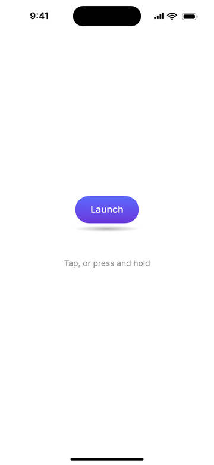

```swift
import FlyingButton

FlyingButton("Launch") { launch() }        // a tap calls the action as usual
```

- **Press and hold:** the capsule crouches for ~0.15 s while the engine spools up (thrust),
  then springs up to ~24 pt and hovers with a gentle 1.1 Hz bob (airborne). Its contact
  shadow shrinks and fades as it rises.
- **Release:** it floats down on a soft spring, touches down with a tiny (~1 pt) bounce and
  goes idle. Releasing during the spool-up just settles without taking off.
- **Plume:** a seeded particle emitter under the capsule (140 puffs/s during thrust, 70/s
  while hovering, a short puff on landing). Puffs shoot down and outward, skid along the
  ground, rise as they cool and fade from ember yellow → orange → warm smoke.
- **Haptics:** a medium impact at liftoff and a light one at touchdown.
- **Room to draw:** the plume and shadow draw behind and below the capsule (a 200 × 96 pt
  area) and never intercept touches.

### 🎞️ GrainyRingGallery

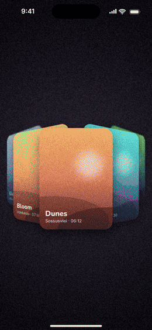

```swift
import GrainyRingGallery

GrainyRingGallery(cards: RingPhotoCard.samples)        // 8 gradient "photo" cards + captions

GrainyRingGallery(cards: albums, grain: 0.15,           // your own cards
                  accessibilityTitle: { $0.title }) { album in
    AlbumCover(album)
} detail: { album in                                    // shown under the enlarged card
    TrackList(album)
}
```

- **Ring:** card *i* sits at *i* · 360°/N. Its angle sets the x offset (radius 140 pt), a
  rise towards the back (46 pt), and a yaw of up to 52° so side cards face outwards (via
  `rotation3DEffect`). Depth (`(cos θ + 1) / 2`) drives the rest: scale 1 → 0.52, opacity
  1 → 0.32, blur 0 → 5 pt and `zIndex`. The yaw eases back to 0 behind, so no card shows
  its back.
- **Drag:** 120 pt of drag turns the ring by one card, and it follows your finger. On release
  it coasts on the fling velocity with exponential friction (4/s, capped at 14 cards/s).
  Below 1.6 cards/s a spring (k 150, ζ 0.86) settles it onto the card nearest the projected
  stop. Touching a spinning ring catches it dead.
- **Detail:** tap the front card and it grows into a detail view via
  `matchedGeometryEffect`, with your `detail` content below it; tap ✕ or the backdrop to
  close. Tapping a side card turns it to the front the short way round. A selection haptic
  ticks as each card passes the front.
- **Grain:** a Metal `[[stitchable]]` `colorEffect` (`Resources/FilmGrain.metal`) adds
  monochrome grain that's strongest in the midtones. It's driven by
  `TimelineView(.periodic(by: 1/12))`. The core quantises time to 12 fps and hashes each
  frame into a seed, so the grain jumps like projected film rather than crawling like static.
  The gallery paints its own dark backdrop so the grain covers the whole view.
- **Core:** `RingGalleryModel` (placement, drag/momentum/snap, `step(by:)`, `select(_:)`,
  `frontIndex`, `grainFrame(at:)` / `grainSeed(at:)`) is plain Swift and fully tested.

### 🧭 LiquidMetalCompass

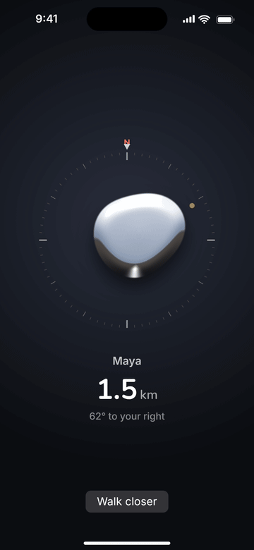

```swift
import LiquidMetalCompass

LiquidMetalCompass(friendName: "Maya", friendBearing: 62, distance: 1_240)
LiquidMetalCompass(friendName: "Maya", friend: maya, from: me, units: .imperial) // great-circle
LiquidMetalCompass(friendBearing: 62, headingSource: ManualHeadingSource())        // your own sensor
```

- **Pointing:** the friend's bearing is fixed in the world. The blob leans toward
  *bearing − heading*, always the short way round (350° → 10° is +20°), on an underdamped
  spring (k 70, ζ 0.38, ~27% overshoot), so every turn swings past and wobbles back.
- **Stretch:** a second, bouncier spring (k 140, ζ 0.28) sets the stretch: 0.42 at rest,
  up to +0.32 more while swinging fast (full at 240°/s), so the liquid flings out and
  jiggles as it settles. The outline is a circle with a rounded cos-power lobe toward the
  friend; the far side pulls in, the centre leans, and the area is renormalised so the
  liquid's volume never changes.
- **Chrome:** the blob is drawn as a dome-shaped height field and blurred. A Metal
  `[[stitchable]]` `layerEffect` (`Resources/LiquidChrome.metal`, loaded with
  `ShaderLibrary.bundle(.module)`) cuts a crisp metaball edge, derives normals and reflects
  a studio (sky, dark floor, horizon line, two softboxes). The studio turns with the
  heading, like a real metal object reflecting a fixed room. A tick dial turns with the
  heading too, so north stays north.
- **Dead on:** within 4° you're aligned (and stay aligned until 8°: hysteresis). Each new
  alignment plays a soft haptic (`.impact(flexibility: .soft)`), at most every 0.35 s; the
  blob glows warm and the caption reads "Dead ahead".
- **Distance:** shown with `.contentTransition(.numericText(value:))`, rounded per band
  (1 m < 100 m, 10 m < 1 km, 0.1 km < 10 km; imperial uses ft, then 0.1 mi).
- **Heading:** behind a `HeadingSource` protocol. `HeadingSources.automatic()` picks
  `MotionHeadingSource` (CMMotionManager, north-referenced attitude, 60 Hz), falling back
  to `LocationHeadingSource` (CLLocationManager; true north when location access is
  granted, magnetic otherwise). In previews, the simulator or on a Mac, **drag sideways to
  fake the heading** (0.5°/pt, dragging right turns right).

### 🧶 SweaterRail

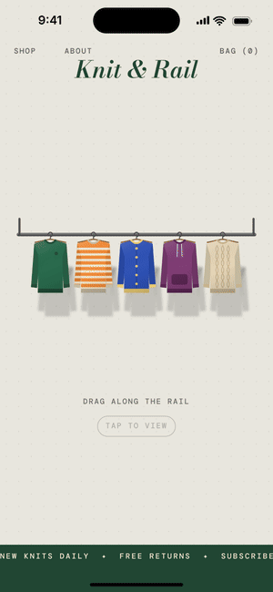

```swift
import SweaterRail

SweaterRail()                                     // five sample knits drawn from shapes
SweaterRail(garments: myKnits, brand: "Loop", ticker: "FREE RETURNS  ✦  ")
```

- **Dock falloff:** each garment's magnification is a raised cosine of its distance from the
  finger (1.5× directly under it, fading to 1× at 150 pt). Widths grow with the scale and the
  row is re-anchored so the point under your finger stays under it, so neighbours are pushed
  apart on both sides, exactly like the Dock. The hovered garment also drops 6 pt forward,
  its wall shadow grows and softens, and a selection haptic ticks as you move between items.
- **Springs and swing:** every hook rides a lively spring (k 260, ζ 0.72). Each garment hangs
  from its hook on a damped pendulum driven by the hook's own acceleration
  (θ'' = −(g/L)·sin θ − (a/L)·cos θ − cθ', L 110 pt, period ≈ 0.93 s), so a spread
  sets the whole rail swinging and it rocks to rest.
- **Hero:** tap a garment and it flies to a detail page with `matchedGeometryEffect`, while
  the rest slide off left and right on staggered springs (neighbours first, 40 ms apart). ✕
  sends it back.
- **Marquee:** a ticker scrolls along the bottom at 40 pt/s, wrapping seamlessly with just
  enough copies to cover the width.
- **Core:** `DockFalloff`, `RailLayout`, `Pendulum`, `SweaterRailModel`, `RailExit` and
  `Marquee` are plain Swift and fully tested. The springs come from the shared
  `WhimsySpring` in WhimsyCore.

### 🔤 FontCollection


```swift
import FontCollection

FontCollection()                                    // 16 built-in faces, "Fontastic" on the flip board
FontCollection(headline: "Hello", seed: 68)         // your own word; a fixed seed fixes the flip sequence
FontCollection(fonts: FontCatalog.standard.specimens.filter { $0.category != .script })
```

- **Fonts:** only faces that ship with iOS 17 and macOS 14; no font files are bundled. The
  four system designs (SF Pro, New York, SF Rounded, SF Mono) plus Avenir Next, Futura,
  Georgia, Baskerville, Rockwell, Chalkboard SE, Marker Felt, Menlo, American Typewriter,
  Didot, Copperplate and Snell Roundhand, via `Font.custom(_:fixedSize:)` by family name.
  Each specimen has a category (serif, sans, rounded, mono, display, script), a sample
  phrase, a note and the weights the family really has. If a family is missing on a device
  (checked once with Core Text), the category's system design stands in.
- **Flip board:** the headline is a row of split-flap cells. It flaps through 14 seeded
  random fonts (no repeats, the target only at the end), with gaps easing from 50 ms to
  260 ms (ease-in, exponent 2.6). Each flap's top half folds down and the bottom half lands
  (`rotation3DEffect`), and the cells follow column 0 28 ms apart, so each flap runs across
  the word like a wave. The final flap falls 1.8× slower, then "set in Didot" pops in.
  Tap the board to shuffle to another font.
- **Haptics (iOS):** a light tick per flap that grows stronger as the board slows
  (intensity 0.3 → 0.8), a firmer impact when it lands, a soft tick as each card lands after
  a filter change, selection ticks on chips and weight detents. The core rate-limits them
  to one per 40 ms (the settle always plays).
- **Chips & regroup:** All · Serif · Sans · Rounded · Mono · Display · Script, with counts.
  The selected pill slides (`matchedGeometryEffect`) and the row scrolls it into view.
  Cards that stay visible fly to their new slot on a closed-form spring (response 0.52 s,
  ζ 0.72), hopping on an arc (0.12 pt per pt travelled, ≤ 36 pt) with a seeded tilt of up to
  ±9°, staggered 45 ms per slot so they land in reading order. Newcomers grow in from below;
  leavers shrink and fade in 0.24 s.
- **Detail:** tap a card and it grows into a detail view (`matchedGeometryEffect`) with
  editable sample text (≤ 80 characters; empty shows the pangram), a size slider (18–120 pt),
  a weight slider with one detent per real weight, and an 80-glyph strip (A–Z, a–z, 0–9,
  punctuation). Tap ✕ or the backdrop to close.
- **Core:** `FontCatalog` (filter/sort/search), `FlipBoardSchedule`, `SpecimenGridLayout`
  + `RegroupPlan` (flights, poses, landing times), `SpecimenDetailState`, `HapticGate`, and
  `FontCollectionModel`, which ties them together and returns due haptics from `step(_:)`.
  All plain Swift and fully tested (42 tests).

### 🫠 FollowBlobHero

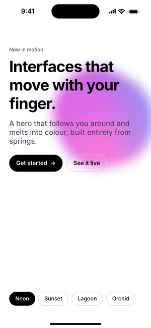

```swift
import FollowBlobHero

FollowBlobHero()
FollowBlobHero(headline: "Ship delightful apps.", subhead: "…", primary: "Start free") { signUp() }
```

- **Delayed chase:** the blob follows your finger (or the pointer on macOS) through two springs
  in series: a critically damped leader (k 38) pulled by the finger, and a bouncy follower
  (k 95, ζ 0.55) pulled by the leader. That gives a lazy lag, then a soft overshoot.
- **Squash and stretch:** the outline stretches along the velocity (up to +45 % at 1,400 pt/s)
  with its area preserved, and three slow travelling lobes (k = 2, 3, 5) make it wobble more
  the faster it moves.
- **Colour:** a 3 × 3 `MeshGradient` on iOS 18 / macOS 15 whose control points drift and lean
  with the motion, falling back to nine soft circles at the same points on iOS 17 / macOS 14.
  Palette chips (Neon, Sunset, Lagoon, Orchid) crossfade over 0.6 s with a selection haptic.
- **Idle:** let go and the blob drifts on a slow Lissajous loop around its home point.
- **Core:** `ChaseSpring`, `BlobMorph`, `MeshField`, `BlobPalette` and `FollowBlobModel` are
  plain Swift and fully tested, built on the shared `WhimsySpring2D`.

### 🌗 MoonPhaseScrubber

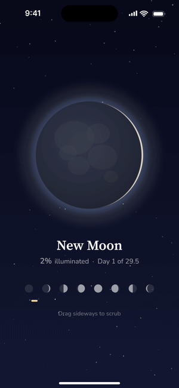

```swift
import MoonPhaseScrubber

MoonPhaseScrubber()                                   // starts just after new moon
MoonPhaseScrubber(initialPhase: 0.5) { phase in print(phase.title) }

// The shape on its own: Animatable, so withAnimation { phase = 0.5 } waxes it.
MoonView(phase: phase).fill(.white).frame(width: 120, height: 120)
```

- **Shape:** `MoonView` is an `Animatable` `Shape` whose `animatableData` is the phase (0 new,
  0.25 first quarter, 0.5 full, 0.75 last quarter). The lit region is the limb semicircle on
  the lit side closed by a terminator half-ellipse with x-radius `r·cos(2π·phase)`: r at new
  moon (nothing lit), 0 at the quarters (a straight line), −r at full. Its area is exactly
  (1 − cos 2πp)/2 of the disc, which the tests check.
- **Scrubbing:** a horizontal drag moves the phase 1:1 (360 pt per lunation, 45 pt per named
  phase). On release the flick is projected 0.12 s ahead (at most two phases past where you let
  go) and a spring (k 160, ζ 0.62) snaps to the nearest of the eight named phases, overshooting a
  little, with a soft haptic. Snaps across new moon take the short way round. You can also tap
  one of the eight small moons in the track.
- **Bonus:** a faint blue earthshine glow lights the dark disc near new moon
  (0.32·max(cos 2πp, 0)³, gone by the quarters). The phase name and the illuminated percentage
  roll with `.contentTransition(.numericText())`, counting down when you scrub backwards.
- **Core:** `MoonMath`, `MoonPhaseName`, `MoonFormatting` and `MoonScrubModel` are plain Swift
  and fully tested, built on the shared `WhimsySpring`.

### 🧵 ClothPoster

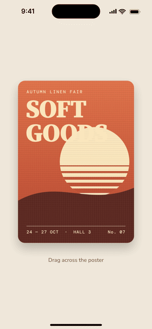

```swift
import ClothPoster

ClothPoster()                                          // the sample screen-print
ClothPoster(size: CGSize(width: 280, height: 380), accessibilityLabel: "Gig poster") {
    Image("gig-poster").resizable().scaledToFill()
}
```

- **Ripples:** touch the card and circular waves leave your finger: height
  `A·sin(k·d − ω·t)` behind a soft front moving at 230 pt/s (wavelength 52 pt), fading over
  240 pt. A Metal `distortionEffect` (`clothRipple`) pulls each pixel along the radius by that
  height, taking the touch position, time and amplitude as uniforms. The card is padded by 14 pt,
  so its edges ripple too.
- **Amplitude:** while you touch, a spring (k 60, ζ 0.9) follows 3.5 pt plus 0.008 pt per pt/s of
  drag speed, capped at 10 pt, so a fast swipe raises taller crests. Let go and it rings down on
  an underdamped spring (k 34, ζ 0.22): the cloth flaps through flat a few times and settles in
  about 3 s. The effects switch off once it is still.
- **Sheen:** a `colorEffect` (`clothSheen`) treats the ripple as a height field lit from the
  upper left. Slopes facing the light brighten, those facing away darken, and a Blinn-Phong
  highlight (above the flat-cloth baseline) glints on the crests.
- **Haptics:** a light impact ticks for every new crest (one per 0.23 s period) while the
  amplitude is at least 1.5 pt, at most every 0.12 s, with its intensity following the
  amplitude, so the ticks fade out as the cloth rings down.
- **Core:** `ClothWave`, `ClothShading` and `ClothModel` are plain Swift and fully tested. They
  mirror the shader's maths line for line, and the amplitude uses the shared `WhimsySpring`.

### 🖼️ TiltPhotoGrid


```swift
import TiltPhotoGrid

TiltPhotoGrid()                                        // intro, then the grid
TiltPhotoGrid(phrases: ["NORTH WIND", "FIELD NOTES 2026"], useDeviceMotion: false)
```

- **Kinetic intro:** heavy black italic words slam in one at a time (every 0.14 s, landing
  22 % oversized and dropping to size in 90 ms, with a rigid haptic per cut) and hard-cut
  through three phrases: "WHIMSY STUDIO", "PHOTO ALBUM 2026", "2026 SHOWCASE APERTURE". The type
  then shrinks, rises and fades over 0.45 s.
- **Reveal:** as the type goes, 18 generated portrait cards (gradient backdrops with sitters
  drawn from circles, capsules and arcs; no photos) pop into a three-column masonry grid in a
  ripple from the centre, each on a slightly bouncy 0.6 s spring.
- **Tilt:** the whole grid is one plane. Touch it and it tilts away from your finger (up to 16°
  of yaw and 14° of pitch, via `rotation3DEffect` with perspective) and pans the other way, on
  springs (k 70, ζ 0.62). Each card floats at its own seeded depth and drifts up to 18 pt more
  for parallax. On iPhone, Core Motion attitude drives the same input when you aren't touching.
- **Core:** `KineticIntro`, `MasonryGrid`, `PortraitSpec`, `PlaneTilt` and `MotionTilt` are
  plain Swift and fully tested, seeded with `SeededRandom` and sprung with `WhimsySpring2D`.

### ⌚ ScrollSpinWatch

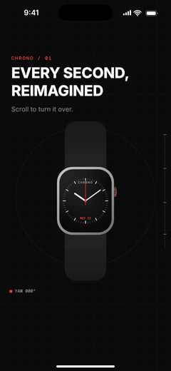

```swift
import ScrollSpinWatch

ScrollSpinWatch()          // full-screen; scroll to turn the watch over
```

- **Scroll-scrubbed turn:** a smartwatch built entirely from shapes (strap and case slices,
  edge faces, dial, caseback, crown) fakes 3D by giving every layer its own
  `rotation3DEffect` and an offset from projecting its depth, painted back-to-front.
  Scrolling four screens turns it front → side → back → front (0° → 90° → 180° → 360°),
  with holds at each pose. Side faces and slices take the light, so the profile and the
  caseback shade as they turn.
- **Synced copy:** each pose has a text block ("EVERY SECOND, REIMAGINED", "11.2 MM. ONE
  BILLET.", "SAPPHIRE, BOTH SIDES.") that fades and slides up as its hold arrives. The tour
  ends on a stats row (47 mm · 100 m · 36 h) counting up with `.contentTransition(.numericText())`
  and the line "Machined, not molded." A red seconds hand, a yaw readout and a progress rail
  are the small red accents.
- **Scroll input:** `onScrollGeometryChange` on iOS 18 / macOS 15, with a `GeometryReader`
  fallback on older systems.
- **Core:** `KeyframeTrack` (sorted keyframes with per-segment easing), `SpinStory` (yaw
  track, section opacity/offset, stat count-up) and `WatchProjection` (layer placement, paint
  order, Lambert-ish shading) are plain Swift and fully tested.

### 🛍️ BoutiqueBurst

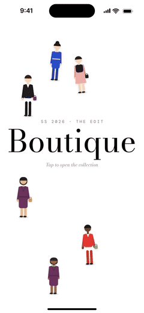

```swift
import BoutiqueBurst

BoutiqueBurst()                                   // "Boutique" and 42 looks
BoutiqueBurst(word: "Atelier", figureCount: 36)
```

- **Rest:** a large Didot "Boutique" on white with six paper-doll cutouts scattered around it,
  placed by seeded rejection sampling so they clear the word and each other.
- **Burst:** tap anywhere (or swipe up) and 42 figures fill the screen on a jittered six-column
  grid, each on `.spring(duration: 0.6, bounce: 0.25)` delayed by its distance from your finger,
  so the crowd ripples out from the touch.
- **Focus:** tap one figure and it stays put while the others fade and slide straight away from
  it, nearest first. It then flies into a detail view (name, price, colourway, Add to bag) via
  `matchedGeometryEffect`; Close sends it back and the crowd ripples home.
- **Figures:** drawn from rounded shapes in a `Canvas` (five garments, twelve outfit colours,
  hair, skin, bag or scarf), generated from a seed. No photos or artwork.
- **Core:** `FigureSpec`, `BoutiqueLayout` (scatter, burst grid, stagger delays, exit offsets,
  spring progress) and `BoutiqueModel` (the rest → burst → focusing → detail machine) are plain
  Swift, fully tested and seeded with `SeededRandom`.

### 🏷️ PeelableSticker

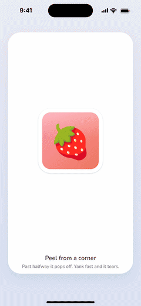

```swift
import PeelableSticker

PeelableSticker()                                 // six emoji stickers in turn
PeelableSticker(prompt: "Peel me")
```

- **Peel:** drag from any of the four corners and the sticker folds back along your finger.
  The crease is the perpendicular bisector of corner → finger; the part on the corner's side
  is clipped off and reflected over the crease as a flap showing the sticker's lighter back,
  shaded where it curls, with a soft shadow on the card along the fold and a drop shadow under
  the flap. No Metal: just polygons, clips and gradients in a `Canvas`.
- **Release:** let go before half of the sticker is lifted and the corner springs back flat
  (carrying your release velocity). Past halfway it pops off: it launches along the peel with a
  spin, falls under gravity, fades out while the fold relaxes, and a fresh sticker lands.
- **Tear:** yank faster than 2000 pt/s along the peel and it tears along the crease into two
  jagged pieces. The lifted half flies off, the stuck half lets go a beat later, and a faint
  glue patch fades from the card.
- **Haptics:** `.sensoryFeedback(.impact(flexibility: .soft, intensity: 0.9))` on the pop,
  `.impact(weight: .heavy)` on a tear and `.selection` when you grab a corner.
- **Core:** `Polygon` (Sutherland–Hodgman clip, area, centroid), `FoldLine`, `PeelState`
  (flat, lifted, flap, crease, fraction), `PeelRules` with a `VelocityTracker`, `TearGeometry`,
  `TumblePhysics` and `PeelModel` (the peel → spring-back / pop / tear → respawn machine) are
  plain Swift and fully tested.

### ❄️ FrostCard

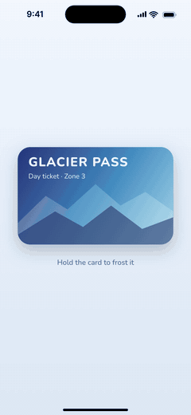

```swift
import FrostCard

FrostCard()                                       // "GLACIER PASS" day ticket
FrostCard(title: "NORTH FACE", subtitle: "Base camp · 4,200 m")
```

- **Frost:** touch and hold the card and ice crystals grow in from all four edges. About 22
  stems start at seeded points along the perimeter, angled within 20° of straight inward;
  each branches into 3, then 2, then 2 children at 60° (± 6°), alternating sides, each
  generation 42–60 % as long and 62 % as wide: 484 segments, the same every time.
- **Growth:** every segment grows at the same speed, and a child starts exactly when its
  parent's tip passes the point it sprouts from, so the frost creeps rather than pops. Three
  seconds of holding grows it all; a milky haze thickens from the edges as it goes.
- **Melt:** let go and progress runs backwards over 1.3 s (youngest twigs retract first) under
  a soft blur, while every fourth branch that melts away drops a bead of water that slides down
  to a terminal speed and fades.
- **Haptics:** the core emits a spawn event for each new branch; the view plays
  `.sensoryFeedback(.impact(weight: .light, intensity: 0.55))` on a throttled tick counter
  (at most one tick every 70 ms) so it feels like crackling, not buzzing.
- **Drawing:** one `Canvas` inside a `TimelineView(.animation)` that pauses when the card is
  clear: round-capped strokes with a soft glow pass for the stems, no Metal and no images.
- **Core:** `CrystalPattern` (seeded generation), `CrystalBranch` (growth and tip at a
  progress), `FrostModel` (hold/melt progress, spawn/melt events, haptic throttle, blur) and
  `Droplet` (gravity against drag) are plain Swift and fully tested.

### 🌈 HoloFoilCard

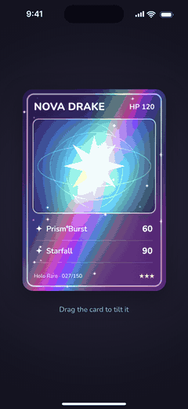

```swift
import HoloFoilCard

HoloFoilCard()                                    // "NOVA DRAKE", HP 120
HoloFoilCard(title: "COMET FOX", hp: 90)
```

- **Tilt:** drag anywhere on the card. The translation maps to yaw and pitch at 0.12° per point,
  through a `tanh` soft clamp, so it's linear near rest and eases into ±15° without ever passing it.
  Dragging right pushes the right edge away and dragging up pushes the top away, as if you were pressing
  the card. Two `rotation3DEffect`s (pitch, then yaw, perspective 0.5) tilt it.
- **Spring back:** while you drag, the tilt chases the finger through a stiff, nearly critical
  spring (k 420, ζ 0.9). Let go and it returns through k 170, ζ 0.5, so it wobbles once past flat.
- **Foil shader:** `HoloFoil.metal` is a `[[stitchable]]` `colorEffect` loaded with
  `ShaderLibrary.bundle(.module)`. A Gaussian rainbow band (cosine palette) slides along a shallow
  diagonal as the card tilts, reaching past the corners at full tilt. Under it sit a faint all-over
  foil tint and a soft glare that slides the opposite way.
- **Sparkles:** half the cells of a 14 pt grid hold a four-point glint. Each glint has its own
  hashed angle window (lowbias32), so it only lights when the tilt comes within 0.35 of that window.
  Tilt the card and different glints come and go.
- **Haptics:** the core emits an event whenever the band crosses the card centre, with ±0.04
  hysteresis and at least 120 ms between ticks. The view plays
  `.sensoryFeedback(.impact(weight: .light, intensity: 0.5))` on the crossing counter.
- **Core:** `HoloTilt` (drag → tilt, soft clamp), `HoloModel` (springs, events),
  `CenterCrossingDetector` and `HoloShading` (band, palette, sparkle gating, glints and the full
  premultiplied shade) are plain Swift and tested. `HoloShading` mirrors the shader line for line,
  and a test checks that the `.metal` constants match it.

### 🎨 OilPaintRestore

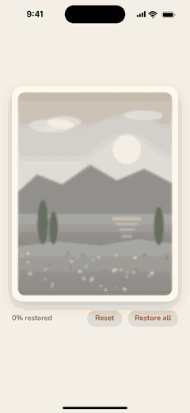

```swift
import OilPaintRestore

OilPaintRestore()                                 // "Lakeside, 1962"
OilPaintRestore(caption: "Harbour at dusk")
```

- **Photo:** a procedurally drawn landscape (sky gradient, sun, mountains, lake, cypresses and a
  seeded meadow of flowers), shown greyscale and blurred under a faint paper wash. The full-colour
  copy sits above it, masked by your paint.
- **Strokes:** every drag sample is recorded with its timestamp. Width follows speed: 34 pt when slow,
  down to 14 pt by 1400 pt/s, smoothed 35% per sample. Points closer than 2 pt are skipped, and a
  finished stroke is simplified with a width-aware Ramer–Douglas–Peucker (0.75 pt, 1 pt of width),
  so the taper survives.
- **Mask:** a `Canvas` draws each stroke as round-capped segments under its own blur. A wet stroke
  has 6 pt soft edges, which tighten to 1.5 pt as it dries.
- **Wet paint shader:** `OilPaint.metal` holds two `[[stitchable]]` `layerEffect`s loaded with
  `ShaderLibrary.bundle(.module)`. `paintSmear` averages 4 taps back along the newest stroke's
  direction (up to 3 pt while wet). `paintGloss` lights a height field of 7 seeded bristle ridges
  per wet stroke: a Blinn-Phong spec (shininess 18) relative to a flat surface, plus a faint sheen.
- **Drying:** each stroke dries over 2 s on its own. Gloss and smear fade with
  `1 − smoothstep(dry)`, the edges settle, and the core emits a `dried` event per stroke, in order.
- **Haptics:** a light `.sensoryFeedback` impact every 3rd finished stroke, debounced to at most one
  every 0.3 s. The core emits the events.
- **Restore all / Reset:** the buttons (also accessibility actions) fade the whole photo in over
  0.6 s or wipe it back to faded. Percent restored comes from a 4 pt coverage grid.
- **Core:** `StrokeWidth`, `StrokeSimplifier`, `PaintStroke` (bristles, direction), `PaintCoverage`
  (mask falloff), `PaintShading` (smear vector, highlight mirrored from the shader) and `PaintModel`
  (drying, events) are plain Swift and tested. A test checks that the `.metal` constants match.

### 〰️ WiggleMatchSearch

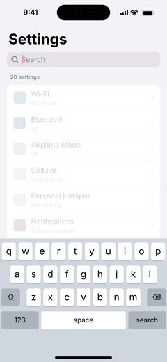

```swift
import WiggleMatchSearch

WiggleMatchSearch()                               // the 20-row settings demo
WiggleMatchSearch(rows: myRows)                   // any [SettingsRow]
```

- **Fuzzy matching:** every query letter must appear in the title in order (ASCII case folding,
  query spaces ignored). A dynamic-programming pass finds the best alignment. Each letter scores 16,
  plus 24 at a word start (after a space or hyphen, or a camelCase hump) and 8 more for the very first
  letter. A letter right after the previous match scores 20, and each skipped letter in between costs 3.
  Letters skipped before the first match cost 1 each, up to 9. Results sort by score, then by shorter
  title, and non-matches drop out. So "sec" finds **Sec**urity before **Se**ar**c**h.
- **Wavy underlines:** each matched letter gets its own sine wave (9 pt wavelength, 2.4 Hz), drawn in
  a `Canvas` and phase-shifted by the letter's index. Each wave tapers to the baseline at both ends,
  so a run of matches reads as one squiggle. A `TimelineView` animates them.
- **Calming:** a keystroke lifts the wave amplitude to 2.2 pt in 80 ms. It then eases down to a flat
  line 0.5 s after the keystroke, and the next keystroke re-energizes it from wherever it is, without
  a jump.
- **Jiggle in:** only letters that weren't matched by the previous query jiggle. Each pops to 1.35×
  and lifts 5 pt, then settles on an under-damped spring (k 260, ζ 0.32), staggered 30 ms per result
  row so a keystroke ripples down the list. The underline stays put while the letter bounces.
- **Haptics:** the core emits a `tick` when a keystroke matches new letters, at most one every
  120 ms. The view plays `.sensoryFeedback(.impact(weight: .light, intensity: 0.6))` on it.
- **Core:** `FuzzyMatcher`, `MatchDiff`, `WaveEnvelope`, `WaveUnderline`, `LetterJiggle` and
  `WiggleModel` (events, timing) are plain Swift and tested.

### 🫗 PourOpenMenu

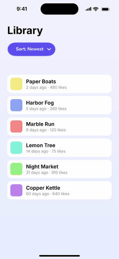

```swift
import PourOpenMenu

PourOpenMenu()                                    // "Sort: Newest" over a small sorted list
PourOpenMenu(options: ["Newest", "Oldest", "Popular", "A to Z"], selected: 2)
```

- **Goo:** the pill and the four option drops are drawn as rounded blobs into a `Canvas` layer with
  `blur(radius: 8)` and then `alphaThreshold(min: 0.5)`. Blobs that sit close together melt into one
  shape, and a gap of about 10 pt or more pinches them apart.
- **Drip:** one master clock runs 0 to 0.77 s. Drop *i* starts *i* × 90 ms after the first and takes
  0.5 s on an ease-out-back curve (a 1.2 overshoot), growing from 55% to full size as it leaves the
  pill. Between neighbouring blobs the core builds an hourglass-shaped neck. Its width is 44 pt when
  they touch and falls to nothing at a 10 pt gap, and its waist is thinner than its ends, so a drip
  stretches thin before it lets go. Necks are chained top to bottom, so a drop still trailing in the
  pill bridges to the one ahead.
- **Pour back:** picking an option runs the same clock backwards, so closing is the exact reverse of
  opening and the farthest drop leaves first. Tapping the pill or picking an option while it is
  mid-pour reverses from wherever it is, with no jump.
- **Label crossfade:** "Sort: Newest" and "Sort: Popular" crossfade over 0.28 s on an ease-in-out
  curve. Picking again mid-fade continues from whichever label was dominant.
- **Lift:** while the master clock runs, the pill (with its goo) scales by `1 + 0.04 · sin(progress · π)`.
  Its shadow grows from radius 3 and 10% opacity to radius 16, 8 pt down and 28% opacity, and the view
  sits above its neighbours.
- **Haptics:** the core emits `landed(open:)` and a `haptic` when the pour finishes in either direction,
  at most one every 150 ms. The view plays `.sensoryFeedback(.impact(flexibility: .soft))`.
- **Core:** `PourLayout`, `PourTimeline`, `PourLift`, `PourLabelFade`, `PourCatalog` and `PourModel`
  (state machine, events) are plain Swift and tested.

### 🐙 OctoDoneChecklist

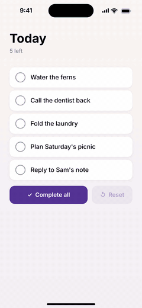

```swift
import OctoDoneChecklist

OctoDoneChecklist()                                   // five sample tasks, Complete all and Reset
OctoDoneChecklist(titles: myTasks, tentacle: false)   // your own rows, ink without the tentacle
```

- **Per-row timeline:** one clock per row. The check draws in over 0.25 s and a halftone blob swells up
  from below until 0.7 s. Then the tentacle grabs the row until 1.0 s, and the pull runs to 1.55 s.
  The collapse starts at 1.3 s, while the pull is still finishing, and ends at 1.8 s.
- **Halftone ink:** the blob is a dot lattice fixed in row coordinates (7 pt apart, odd rows shifted half
  a cell). Each dot's radius is 3.3 pt times a radial falloff, `1 - smoothstep(0, 1, d)`, of its
  normalised distance from the blob's centre, so dots grow in place as the blob swells and the
  edge fades. A 1.4 pt blur softens them.
- **Tentacle:** a curve that starts at the bottom right of the row, runs up the right side, over the
  top and down the left, tightening as it goes. It is drawn as three dots abreast along 44 samples,
  and its width tapers from 14 pt to 1.5 pt, growing with the grab.
- **Squash and stretch:** the row and its ink are scaled `x = 1/y`, so the area never changes. The group
  squashes by up to 12% as the tentacle grabs, then stretches as it is pulled down 72 pt on an
  under-damped spring (stiffness 150, ζ 0.45), which overshoots and rings. The row fades out during the pull.
- **Collapse:** slot heights follow a spring (stiffness 220, ζ 0.55) that overshoots about 13%, so the
  rows below shoot up slightly past their final place and settle back. It blends onto exactly 1 so the
  layout lands cleanly.
- **Tap while animating:** a tap before the grab (the first 0.7 s) undoes the tick, rolling the row's
  clock back at 2x. Tapping again resumes from where it is. Once the ink has grabbed, the row is committed
  and taps are ignored.
- **Complete all:** every row that isn't already on its way, including ones mid-rollback, is scheduled
  280 ms after the one before. A tap on a row still waiting starts it straight away.
- **Reset:** gone rows grow back in over 0.4 s, and rows still mid-flight snap back to unticked.
- **Haptics:** the core emits a `haptic(.grab)` when the grab begins and a `haptic(.gone)` when the row
  has collapsed, each at most once per 120 ms. The view plays a light impact and a soft impact.
- **Core:** `OctoTiming`, `OctoInk` (blob, halftone dots, tentacle), `OctoLayout`, `OctoRowFrame`,
  `OctoModel` (state machine, sweep scheduler, events) and `OctoAnnouncement` are plain Swift and tested.

### 🎵 AsciiNowPlaying

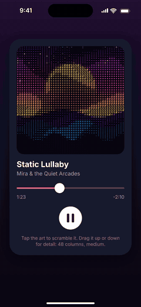

```swift
import AsciiNowPlaying

AsciiNowPlaying()                                          // "Static Lullaby" by Mira & the Quiet Arcades
AsciiNowPlaying(track: AsciiTrack(title: "Paper Moons", artist: "The Low Tides", duration: 187))
```

- **Cover:** there is no image file. A 192 x 192 cover is generated in code: a sky gradient, a striped sun, a few stars and three sine hills. The core samples it at pixel centres, so it is identical on every platform.
- **Downsample:** a box filter with fractional edge weights turns the cover into 24 to 72 columns (48 by default). Each cell keeps its average colour, its luminance and a tint (the colour scaled up to full brightness, so dark cells keep their hue).
- **Ramp:** luminance (`0.2126 r + 0.7152 g + 0.0722 b`) goes through a 0.8 gamma, then picks a glyph from `' .:-=+*#%@'`. Tapping scrambles with that ramp plus 22 punctuation and digit glyphs.
- **Canvas:** each distinct glyph is resolved once in white. A `drawLayer` with `.sourceAtop` fills every cell rectangle in its tint, so thousands of coloured glyphs cost one resolve per glyph.
- **Breathing:** brightness adds `0.14 * sin(2 pi t / 5 s + 7u + 4.5v + 1.2 sin(3 pi v))`, a 5 s wave whose phase changes across the art. The same value brightens the tint by up to 17%. While paused the wave shrinks to 30% in about a third of a second.
- **Scramble:** a tap starts a radial wave from the touch point. Cells begin scrambling within 0.15 s, change glyph 24 times a second, and each resolves at `0.30 s + 0.85 s * distance + up to 0.12 s of jitter`. A resolved cell flashes 50% brighter for 0.18 s. The whole thing ends 1.45 s after the tap. Tapping again restarts it with new glyphs.
- **Seeded and stateless:** every random glyph is `hash(seed, epoch, cell, step)` with a 32-bit integer hash, so a frame can be computed on its own, replays are exact, and the web port matches the Swift output bit for bit.
- **Density drag:** dragging the art 260 pt up goes from 24 columns to 72 and the same distance down goes back. Drag starts from the current density and the type size follows (1.3 times the cell). Grids are cached per column count.
- **Haptics:** the core emits `haptic` when the resolve completes, at most once per 250 ms. The view plays a light impact.
- **Player:** play and pause, a scrubber and `1:23` / `-2:10` labels. A `Slider` seeks. The track ends by stopping at its duration.
- **Core:** `AsciiImage`, `AsciiCover`, `AsciiGrid`, `AsciiRamp`, `AsciiHash`, `AsciiShimmer`, `AsciiScramble`, `AsciiDensity`, `AsciiPlayer` and `AsciiModel` (state machine, events, cells) are plain Swift and tested.

### 💌 DogEarPeelCard

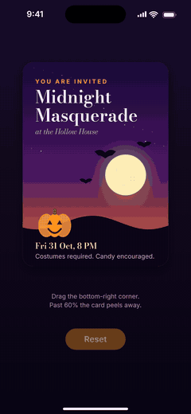

```swift
import DogEarPeelCard

DogEarPeelCard()   // a Halloween invitation with a note hidden underneath, and a Reset button
```

- **Not the sticker:** `PeelableSticker` lifts a small sticker from any corner and tumbles it away. This is a full-size card with one dog-ear, a note under it, and a commit threshold. The fold maths is not repeated: `DogEarCore` imports `PeelCore` and uses its `Polygon` (half-plane clipping, area, centroid), `FoldLine` and `PeelState`, plus `WhimsySpring` and `WhimsyMath` from `WhimsyCore`.
- **Fold:** the crease is the perpendicular bisector of the segment from the corner to your finger. The card (a 300 x 420 rounded rectangle sampled into a polygon) is clipped to the side still lying flat. The other side is reflected across the crease and drawn as a lilac paper back, so the corner tip lands exactly on your finger.
- **Shading:** a `LinearGradient` runs from the crease across the flap. It is black at 14% alpha at the crease (up to 36% fully peeled), clear halfway, and 10% white at the far edge. The flap casts a soft shadow on the card: its outline pushed along the peel direction by 4 to 14 pt, blurred 6 to 16 pt, at 16% to 40% opacity, clipped to the part still flat. The card itself throws a 14 pt shadow onto the note.
- **Peel progress:** finger travel divided by how far the card reaches from the corner along that direction, 0 to 1. It is not the lifted area, because 60% of the area would need a finger outside the card. The area fraction from `PeelCore` is still reported.
- **Clamp:** the finger can pull at most 100% of that reach, so the crease stays on the card and some of it stays flat. Dragging out of the card lifts nothing, and a pull under 0.5 pt is flat.
- **Threshold:** crossing 60% arms the peel and re-arms only after dropping below 57%, so hovering on the line doesn't chatter. Letting go armed peels the card off, and letting go below springs it back. Crossing in either direction plays a light haptic.
- **Spring back:** an under-damped spring on the pull (stiffness 380, damping ratio 0.4). It swings through flat, which closes the fold, and the next swing lifts the corner a few points again before it settles, in under a second.
- **Peel off:** over 0.5 s the pull eases to twice the card's reach, so the crease sweeps across the whole card and the flap is the entire card folded over. Then it flies for 0.55 s, sliding 200 pt along the peel direction, turning up to 0.16 rad about its centre and fading out. The note is revealed and announced after about 1.05 s.
- **Reset:** the card fades back in over 0.5 s, growing from 94% to full size.
- **Haptics:** the core emits `haptic(.threshold)` on a threshold crossing and `haptic(.peelOff)` when the card is released past it, at most once per 120 ms. The view plays a light impact.
- **Reduce Motion:** the spring is critically damped (no wobble), and a peel-off fades the card out over 0.35 s instead of sweeping and flying it. Dragging stays direct.
- **Core:** `DogEarLayout` (card shape, corner, reach), `DogEarRules`, `DogEarShading`, `DogEarContent`, `DogEarModel` (state machine, events, frame) and `DogEarAnnouncement` are plain Swift and tested.

### 🍬 ColorFigureGumball

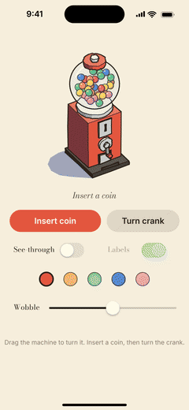

```swift
import ColorFigureGumball

ColorFigureGumball()   // a hand-inked gumball machine: turn it, feed it a coin, look inside
```

- **What it does:** drag the machine and it turns a full 360° with inertia, then settles onto a quarter turn.
  Tap **Insert coin**: the coin slides to the slot and drops, the mechanism unlocks, and you drag (or tap)
  the crank. After one full turn a gumball goes down the chute and rolls out of the flap. **See-through** fades
  the case to a faint outline and shows the coin mech, the pocket wheel, the gear shaft, the chute and the flap spring.
  **Labels** name eight parts and light each one while it works. Five swatches recolour the body (tomato, mustard,
  mint, cobalt, blush) and a slider sets how shaky the ink is.
- **Pure-Swift core:** `ColorFigureCore` builds the machine from boxes, cylinders and rods (dozens of solids), projects it with an
  orthographic camera (yaw any angle, pitch 35.264°, a face is visible when its normal points at the viewer),
  sorts it back to front with a topological painter's order, and inks it. It imports only Foundation, so it tests on Linux.
- **Hand-inked look:** every vertex and every edge gets seeded noise (up to 0.6 and 0.8 units at wobble 1), so the same seed
  always draws the same wobble. Silhouettes are 0.9 units wide, creases 0.5 and hatching 0.2, each varied by up to 25%.
  Fills are three flat tones chosen by the face normal against a light (0.45, 0.55, 0.70), with hatch lines (±52°) on the
  shaded side and a cross-hatch in deep shade.
- **Gumballs:** 34 coloured circles from a seeded SplitMix64 (seed 2718), each at least 1.9 radii from its neighbours,
  stacked in the globe.
- **Turntable:** 0.6° per point of drag, coasting with friction 2.6 per second (capped at 720°/s). Within 12° of a rest
  pose and slow, it eases onto it. Rest poses are the home yaw (−32°) plus quarter turns.
- **Mechanism:** a small state machine (ready, coin dropping, unlocked, turning, dispensing). The coin slides 0.36 s and falls
  0.45 s, the pawl releases in 0.15 s, and the crank angle follows the pointer (up to 7 rad/s) and drives the pocket wheel, which
  advances a quarter turn per full crank turn. The gumball takes 0.9 s down the chute and 0.55 s to roll out, and the flap opens
  for it. A locked crank gives a little wobble.
- **Haptics:** a light impact on the coin drop, on each of the 8 crank detents per turn and when the gumball comes out, at most
  one every 60 ms. The view plays `.sensoryFeedback(.impact(weight: .light, intensity: 0.8))`.
- **Web port:** `webports/gumball.html` repeats the core with the same constants and a scripted session.

#### Credit and licence

Inspired by [Colorfigures](https://april-zhu.com/colorfigures) by April Zhu (MIT): the idea of everyday objects drawn as
hand-inked isometric figures with working buttons, drag-to-turn, a See-through switch with labelled internals, Labels, swatches
and a wobble slider. This is a new Swift implementation: no code, geometry, palette values or assets were copied. The camera
maths, flat tone bands, depth-sort idea, ghosted shell, label pills and swatch names follow its approach. Because ideas and structure
are ported, its licence notice is reproduced here:

```
MIT License

Copyright (c) 2026 April Zhu (Colorfigures: colour, hand-drawn style, 3D props, template, examples)
Copyright (c) 2026 April Zhu (iso-glow, on which Colorfigures is based)
Copyright (c) 2026 Tolga Cohce (iso-figure, on which iso-glow is based)

Permission is hereby granted, free of charge, to any person obtaining a copy of this software and
associated documentation files (the "Software"), to deal in the Software without restriction, including
without limitation the rights to use, copy, modify, merge, publish, distribute, sublicense, and/or sell
copies of the Software, and to permit persons to whom the Software is furnished to do so, subject to the
following conditions:

The above copyright notice and this permission notice shall be included in all copies or substantial
portions of the Software.

THE SOFTWARE IS PROVIDED "AS IS", WITHOUT WARRANTY OF ANY KIND, EXPRESS OR IMPLIED, INCLUDING BUT NOT
LIMITED TO THE WARRANTIES OF MERCHANTABILITY, FITNESS FOR A PARTICULAR PURPOSE AND NONINFRINGEMENT. IN
NO EVENT SHALL THE AUTHORS OR COPYRIGHT HOLDERS BE LIABLE FOR ANY CLAIM, DAMAGES OR OTHER LIABILITY,
WHETHER IN AN ACTION OF CONTRACT, TORT OR OTHERWISE, ARISING FROM, OUT OF OR IN CONNECTION WITH THE
SOFTWARE OR THE USE OR OTHER DEALINGS IN THE SOFTWARE.
```

### 📺 ChannelFlipCard

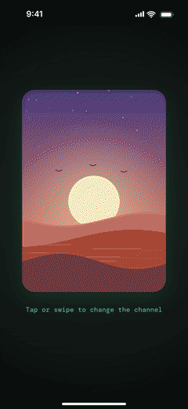

```swift
import ChannelFlipCard

ChannelFlipCard()                                   // six generated photos
ChannelFlipCard(images: [Image("a"), Image("b")])   // your own, with optional captions for VoiceOver
```

- **What it does:** a photo card that changes picture like an old CRT TV changing channel. **Tap** for the next photo: for 0.35 s
  the picture tears sideways in horizontal bands, red and blue pull apart, a bar rolls down the screen, static crackles and the
  photo flashes toward white. The photo is swapped on the brightest frame, then it settles. **Swipe** left for next, right for
  previous: a slow swipe is a short, mild glitch and a fast flick is a longer, stronger one. A green "CH 03" number fades in and out.
- **Discrete frames:** the effect updates 15 times a second, whatever the display rate, so it jitters like a TV instead of gliding.
  A transition shows `round(duration × 15)` frames, at least 3 and always odd (a tap shows 5, a flick 11), so the middle frame
  sits exactly at progress 0.5. Frame `i` of `n` is at progress `(i + 1) / (n + 1)`, never exactly 0 or 1, so every frame has some glitch.
- **Envelope and swap:** intensity is `sin(π·progress)^1.2` times the strength (0.6 for a tap). It peaks on the middle frame,
  and that is exactly the frame on which the photo underneath is swapped and the light haptic fires, however large a frame step the display takes.
- **Tears:** the card is cut into 7-point bands. Each band hashes (lowbias32 of the frame seed and the band number) to decide
  whether it tears, with chance `0.3 + 0.6 × intensity`, and by how much: up to 14 % of the width × intensity either way, wrapping
  round the edges. The seed changes every frame, so every frame tears differently, and the same seed always tears the same way.
- **The rest of the look:** red and blue are sampled `4 % of the width × intensity` either side of green. Odd 2-point rows dim by up to 12 %,
  the picture brightens up to 30 %, 2-point static cells add up to ±0.35, and the whole thing mixes toward white by `0.55 × intensity²`.
  A rolling bar (±7 % of the height around the progress row) always tears its bands, 1.5× as far, and its static is 1.5× as strong.
- **Swipe speed:** the speed of the last 0.12 s of the drag (a finger that stopped before lifting counts as slow) maps linearly from
  250 pt/s to 2200 pt/s onto a duration of 0.35 s to 0.7 s and a strength of 0.45 to 1.0, clamped. Under 12 pt of movement is a tap;
  a mostly horizontal drag of at least 24 pt is a swipe; anything else does nothing.
- **Rapid taps:** a change that hasn't reached its swap yet is swapped at once before the next one starts, so quick taps never stall.
  Haptics are at most one every 80 ms and play `.sensoryFeedback(.impact(weight: .light, intensity: 0.5))`.
- **Channel number:** "CH 01" to "CH nn", one-based with two digits, in old-TV green with a glow. It fades in over 0.12 s, holds
  for 1.6 s and fades out over 0.6 s, after which the timeline pauses. `showsChannelNumber: false` hides it and
  `staticNoise: false` turns the static off.
- **Pure-Swift core:** `ChannelFlipCore` owns the envelope, frame quantization, swap-moment detection, band hashing, split and
  flash amounts, the speed mapping, the gesture classifier, the velocity tracker, index wrap, the state machine and the six generated
  scenes. It imports only Foundation, so it tests on Linux (110 tests). A test reads the `.metal` file and checks its constants,
  hash constants and signature against the core.
- **Metal shader:** `ChannelFlip.metal` is one `.layerEffect` with `progress`, `intensity`, `seed` and `noiseAmount` (plus the card
  size), loaded with `ShaderLibrary.bundle(.module)`, and `maxSampleOffset` of the card width for the tears. At intensity 0 the effect is switched off.
- **Photos:** six generated pictures (dunes, lagoon, city, alps, neon grid, paper garden) drawn from gradients, circles, polygons and
  lines, so it works without any assets. The shader treats `Image` photos the same way.
- **Web port:** `webports/channelflip.html` repeats the core and the shader per pixel with the same constants and a scripted session.

### 🗺️ ContourInkLoader

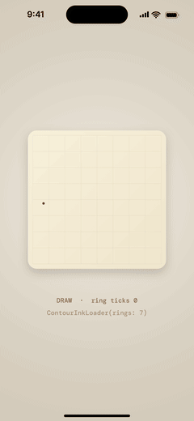

```swift
import ContourInkLoader

ContourInkLoader()                                              // seven rings, sepia ink
ContourInkLoader(rings: 6, ink: .indigo, isAnimating: loading)  // 3 ... 12 rings, your own ink colour
```

- **What it does:** a loading indicator that sketches a topographic map. Seven nested, wobbly contour rings are drawn one after
  another on a cream sheet, as if by a pen with a small nib dot at the drawing tip. When the last ring closes, a small red dot climbs a
  switchback route from the outer ring to the peak and leaves a dashed red trail. The sheet then tilts back about 25°, fades out and the loop starts again.
- **Rings:** each ring is a closed path from a circle perturbed by three sine harmonics (2, 3 and 5 lobes, amplitudes 7 %, 4.5 % and 2.5 %
  of the radius, each scaled by 0.85 to 1.15 and given a seeded phase that drifts a little from ring to ring, so neighbours look related).
  Radii shrink from 0.43 to about 0.12 of the sheet, and the centres drift toward an off-centre peak like real terrain. Every third ring is an
  index contour, drawn twice as thick (2.2 pt against 1.1 pt). Each ring starts its stroke at its own angle. The default seed is `0x30C7`.
- **Rings never intersect:** `ContourMap.make` measures the smallest gap between neighbouring rings (the nearest distance between the two
  polylines, negative if the inner ring is not entirely inside the outer one). If it is under 0.01 of the sheet it tries the wobble again at
  0.85, 0.7, 0.55, 0.4, 0.25, 0.1 and finally 0 (plain circles, which always fit). Containment is transitive, so all pairs of rings are disjoint. Tests sweep
  every count from 3 to 12 over many seeds and assert `minGap > 0`.
- **Timeline:** a pure function of time. Each ring starts 0.12 s after the one outside it and takes 0.5 s, eased in and out, as `.trim(from: 0, to:)`.
  Then the dot climbs for 1.2 s (eased), the sheet tilts for 1.2 s (0.8 s of easing to 25°, then rest), fades for 0.6 s and a blank sheet
  fades back in for 0.35 s. For seven rings one loop is 4.57 s.
- **Route:** one waypoint on each ring (the angle turns 0.28 rad per ring, with every odd ring shifted a further 0.5 rad for switchbacks and a small seeded
  jitter), ending at the peak. A Catmull-Rom curve with ten steps per leg is walked by arc length, so the dot moves at an even pace along the path.
- **Tilt:** `.rotation3DEffect(.degrees(tilt), axis: (x: 1, y: 0, z: 0), perspective: 0.7)`, then `.opacity` for the fade.
- **Haptic:** `.sensoryFeedback(.impact(weight: .light, intensity: 0.4))` as each ring closes. The core reports events for each frame step,
  `ringClosed(k)`, `dotArrived` and `looped`, over the half-open interval `(t0, t1]`, so every ring ticks exactly once per loop however the frames
  fall, even when one step spans several rings or a whole loop. A stalled timeline is capped at 0.25 s per step.
- **Pure-Swift core:** `ContourInkCore` owns the hashing, ring geometry and sampling, the non-intersection guarantee, the route, the
  timeline phases, per-ring trims, the pen nib, dot position, tilt, opacity, ripple, the events and the running model. It imports only Foundation
  (through `WhimsyCore`), so it tests on Linux (134 tests, Swift Testing).
- **Reduce Motion:** the loader shows a finished, flat map with every ring drawn and the red dot sitting at the peak. Nothing animates, nothing ticks.
  `isAnimating: false` shows the same picture.
- **Web port:** `webports/contourink.html` repeats the core with the same constants. A temporary test checked 131 lines of output (geometry, route, frames, events and a
  1500-step model run) between the Swift core and the port, and they matched exactly.

### 📚 ShelfPull

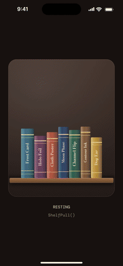

```swift
import ShelfPull

ShelfPull()                                                       // seven books, each with a small demo
ShelfPull(books: [                                                // 3 ... 9 books of your own
    ShelfBook(title: "Notes", color: .teal) { MyNotesView() },
    ShelfBook(title: "Maps", color: .orange) { MyMapView() },
    ShelfBook(title: "Songs", color: .purple) { MySongsView() },
])
```

- **What it does:** a wooden shelf with seven book spines of different heights, widths and colours, each with a vertical title and a few gold
  bands. Drag a spine upward and it slides out of its slot against a rubber band while its neighbours lean into the gap. Pull past the
  commit distance, or flick, and the book lifts free, turns 90° about its vertical axis to show its front cover, and the cover grows into a card
  with a small live demo. Tap outside the card (or its close button) and the card shrinks back to the book, which turns round and slides down
  into its slot. Let go early and the book springs back.
- **Rubber band:** the rise is `x·R / (x + R)` for a pull of `x` points with `R = 0.7 ×` the spine height. It starts at slope 1 and gives less and
  less, and it can never pass `R`. The commit distance is measured on the finger, at 0.55 × the spine height. Past it the pull is "armed" and a light tick plays.
- **Release:** `ShelfResistance.decide` answers `none` (under half a point: a tap), `springBack`, `commitDrag` (pulled to 0.55 × the height or more) or
  `commitFlick` (upward speed of the last 0.1 s of at least 900 pt/s after a pull of at least 12 pt). A finger that paused before lifting counts as slow.
- **Neighbours lean:** books on either side tilt toward the gap, at most 12° for the nearest and half as much for each further book. The angle grows
  with the rise (smoothstep from 5 % to 38 % of the spine height). Two geometric caps make the books rest against each other: the nearest book's top
  never moves further than the slot is wide, and every book's top moves no further than the top of the one nearer the gap plus the gap between
  books. Tests check, for seeds 1 to 25, that no two books overlap at any rise. A book pivots on its bottom corner nearest the gap.
- **Phases:** `resting`, `dragging`, `lifting` (0.45 s), `turning` (0.5 s), `open`, `returning` (card shrinks 0.4 s, book turns back 0.45 s, slides home 0.55 s;
  or a 0.55 s spring after a short pull) and `seating` (0.4 s). `ShelfTimeline.frame` is a pure function of the phase and the time in it, and
  `ShelfPullModel` runs the state machine: pointer down, moved, up and cancel, `activate`, `close` and `step(dt)`, which carries leftover time across phases.
- **Haptics:** the model emits `armed`, `committed`, `opened` and `seated`. `seated` fires exactly once per return, at the moment the book lands, for
  every kind of return, and plays a soft thunk (`.impact(flexibility: .soft, intensity: 0.8)`). Neighbours rock once as it seats.
- **3D turn:** the book is two faces hinged on its edge, the spine at `-turn` and the cover at `90° - turn`, each with `.rotation3DEffect(..., axis: (0, 1, 0), perspective: 0.4)`.
  The widths come from `ShelfTimeline.turnLayout`. The card is a rectangle interpolated from the cover's rectangle on the stage to the card rectangle,
  with the cover fading out and the demo fading in.
- **Pure-Swift core:** `ShelfPullCore` owns the hashing and layout of the spines, the resistance curve, the release decision, the velocity
  tracker, the lean angles, the timeline, the phase machine and the events. It imports only Foundation (through `WhimsyCore`), so it tests on Linux
  (137 tests, Swift Testing).
- **Reduce Motion:** there is no 3D turn and no sliding. The book is activated, and the card fades in over the shelf, and fades out to close.
  The seat is a 0.12 s event with no rocking. The demos on the cards hold still.
- **Web port:** `webports/shelfpull.html` repeats the core with the same constants. A temporary test checked 573 lines of output (layout, resistance,
  lean, every frame of every phase, a scripted session and eight random sessions) between the Swift core and the port, and they matched exactly.
- **Not compiled on Linux:** the SwiftUI view could not be built here (there is no SwiftUI on Linux). It was parse-checked and linted, and the core is tested.
  The direction of `rotation3DEffect` is assumed and has not been seen on a device.

### ✨ StarJar

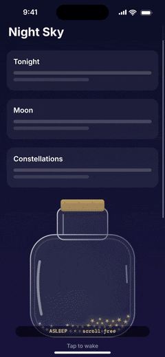

```swift
import StarJar

ScrollView {
    StarJar()                                                     // forty sleeping stars
}
.starJarScrollLock()                                              // scrolling stops while the jar is awake

StarJar(starCount: 60, tint: .mint, isEngaged: $jarAwake)         // 8 ... 80 stars, your colour, a binding
```

- **What it does:** a glass jar with a cork, a rim light and a few highlights, holding about forty stars. Asleep, the stars lie dim in a heap
  at the bottom. Tap the jar and they brighten, twinkle each on its own rhythm and float up to drift like fireflies. Drag a finger inside to stir
  them. Tap outside the jar, or the Done chip, and over about 1.5 s they sink back to the bottom and dim. A small hint reads "Tap to wake" or
  "Tap outside to rest".
- **Scroll lock:** a view can't switch off an ancestor's scrolling by itself, so `StarJar` publishes `StarJarScrollLockKey` and
  `.starJarScrollLock()` on the ScrollView applies `.scrollDisabled` while the jar is waking, awake or settling. Scrolling comes back once the
  stars are asleep. `StarJarDemo()` shows it on a page with cards above and below the jar.
- **Jar:** the inside is the union of two rounded boxes (body and neck), as a signed distance; the cork closes the neck. Each star is pushed
  back out along the outward normal (central differences of the distance) and its outward speed is reflected with restitution 0.5 and friction 0.92.
- **Stars:** seeded (radius, twinkle frequency and phases, four wander frequencies and phases). Gravity `260 × (1 − w²)` at wake level `w`,
  drag that eases from 2.5/s asleep to 1/s awake, firefly wander from summed sines (80 pt/s² at full wake), a soft pull toward the middle of
  the body, and soft separation between stars with contact damping so a heap comes to rest. Fixed 1/120 s substeps; the remainder carries over.
- **Twinkle:** `brightness = level × (1 − amp + amp × (0.5 + 0.35 sin a + 0.15 sin(2.3a + φ₂)))`, `a = 2π f t + φ`. Asleep the level is 0.16 with a faint
  shimmer; awake it is 1 with amplitude 0.5. Drawn with `TimelineView(.animation)` and `Canvas`, paused once the heap is still.
- **Stir:** a swirl round the finger plus a pull toward the finger's own velocity, both fading as `exp(−d²/70²)`.
- **Haptics:** the core emits `brush(star:speed:)` when a star hits the glass faster than 70 pt/s, at most one per 80 ms and only while the jar is
  more than 30 % awake, and the view plays a soft tick (`.impact(flexibility: .soft, intensity: 0.5)`).
- **Phases:** `asleep`, `waking` (0.6 s), `awake`, `settling` (1.5 s); a wake during a settle (or a settle during a wake) starts from the current level.
  Events `waking`, `awake`, `settling` and `asleep` keep an `isEngaged` binding in step.
- **Pure-Swift core:** `StarJarCore` owns the jar geometry and containment, the seeded simulation, the twinkle, the phase machine, the scroll-lock flag,
  the stir field and the rate-limited brush events. Its `sin`, `cos` and `exp` are plain polynomials so other platforms can replay a jar exactly. It imports only
  Foundation (through `WhimsyCore`), so it tests on Linux (82 tests, Swift Testing).
- **Reduce Motion:** no wake kick, no wander and no stirring; on wake the stars glow at a steady 0.72 without twinkling, and the transitions are shorter.
- **Web port:** `webports/starjar.html` repeats the core with the same constants. A temporary test checked 548 lines of output (maths, the distance field,
  seeded stars, twinkle, stir, three scripted sessions and six random sessions) between the Swift core and the port, and they matched exactly.
- **Not compiled on Linux:** the SwiftUI view could not be built here (there is no SwiftUI on Linux). It was parse-checked and linted, and the core is tested.
  The gestures and the haptic have not been tried on a device.

### 🎯 HoldToFanDock

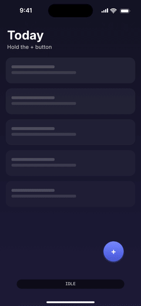

```swift
import HoldToFanDock

HoldToFanDock()                                                   // four demo tabs
HoldToFanDock(items: [                                            // 3 ... 5 tabs of your own
    FanItem(icon: "house.fill", label: "Home"),
    FanItem(icon: "safari.fill", label: "Explore"),
    FanItem(icon: "bell.fill", label: "Alerts"),
    FanItem(icon: "person.fill", label: "You"),
]) { index in go(to: index) }
```

- **What it does:** a floating action button in the bottom-right. Press and hold past about 0.2 s and four tabs spring out along a quarter-circle
  into the upper-left above the FAB, staggered. Drag toward a tab to highlight and scale it; lift over one to select it (a selection haptic) and the
  fan snaps shut. Lift elsewhere, or drag far off the arc, and it cancels with the same snap. A short tap never arms — it only pulses.
- **Arc:** angles use the same convention as `Vec2.unit` (0 right, +π/2 down). The fan runs from straight up (−π/2) to straight left (−π), so the tabs
  sit on a quarter-circle of radius 118 pt. Counts are clamped to 3…5; four is the default.
- **Spring:** a master `WhimsySpring` (k = 220, ζ = 0.72 open; snappier on close) drives the open amount. Each tab's radial progress is a time-shifted
  copy of the spring's closed-form step response (`stagger = 45 ms`), so they fan out one after another. Reduce Motion snaps open and closed with no
  springs and no stagger.
- **Hit test:** the nearest tab by angle wins, but only while the finger is between 36 and 190 pt from the FAB and within 0.38 rad of that tab's angle.
  Too close, too far, or off the quarter leaves the highlight empty and a lift cancels.
- **Phases:** `idle`, `arming`, `opening`, `open`, `closing`. Events: `armed`, `opened`, `selected(index)`, `cancelled`, `seated`, and `pulsed` for a
  tap that never armed. `HoldToFanModel` exposes `tabProgress`, `tabPosition`, `tabScale` and `nearestTab` for the view.
- **Pure-Swift core:** `HoldToFanCore` owns the arm timer, the open spring, the angle layout, the hit test and the select/cancel/seat machine. It imports
  only Foundation (through `WhimsyCore`), so it tests on Linux (31 tests, Swift Testing).
- **Reduce Motion:** no springs and no stagger. The fan snaps open the moment it arms and snaps shut on select or cancel; waking and settling are the
  same events, just instant.
- **Web port:** `webports/holdtofan.html` repeats the core with the same constants. A temporary test checked 181 lines of output (layout, step responses,
  hit tests, four scripted sessions and six random sessions) between the Swift core and the port, and they matched exactly.
- **Not compiled on Linux:** the SwiftUI view could not be built here (there is no SwiftUI on Linux). It was parse-checked and linted, and the core is tested.
  The gestures and the haptics have not been tried on a device.

### 💨 VelocityGlyphScatter

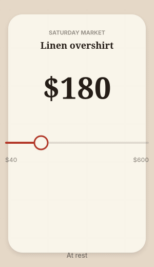

```swift
import VelocityGlyphScatter

@State private var price = 180
VelocityGlyphScatter(value: $price)                         // $40...$600 by $5
VelocityGlyphScatter(value: $price, range: 20...200, step: 5, title: "Fare")
```

- **What it does:** a price, drawn as one `Text` per character, above a slider. The default run is $40 to $600 in $5 steps. While the thumb is moving, each glyph lifts and leans by a seeded amount that grows with speed (clamped), and a fast drag blurs them slightly. Let go and every glyph springs back to the baseline with a small overshoot. A light selection tick fires on each $5 step the price crosses.
- **Grid:** legal values are `lower + n·step`, not past `upper`. Halfway cases round the step index away from zero, so the web port and Swift agree (banker's rounding would not). Dragging across several steps emits one `step` event per grid value entered, including the one you land on, and never a second event for a step you are already on.
- **Glyphs:** the text is a fixed `$` format, not `NumberFormatter` (`"$180"`, `"$1,000"`, `"-$12"`). Digits are identified by place (0 is the ones), so `$99` and `$100` keep the same tens and ones springs and a new hundreds glyph appears on the baseline. Commas are identified by their thousands group.
- **Speed:** thumb velocity is an exponential smoother, `1 - exp(-dt / 0.09)`, with the same Taylor `exp` the star jar uses. Offset, lean and blur scale with `|speed| / 480` and stop growing past that. Peaks are 18 pt, 6° and 1.8 pt of blur. Each glyph's seed keeps a magnitude of at least 0.45, so none of them sit out the scatter. The return spring is k = 240, ζ = 0.55.
- **Pure-Swift core:** `VelocityGlyphCore` owns the grid, the glyph split, the smoother, the seeded scatter and the springs. It imports only Foundation (through `WhimsyCore`), so it tests on Linux (30 tests, Swift Testing).
- **Reduce Motion:** no offset, no lean and no blur. The price still snaps, and the step events still fire.
- **VoiceOver:** one adjustable element labelled with the title (default "Price"). The value is the formatted price, such as `"$180"`. Swiping up or down moves one step.
- **Web port:** `webports/velocityglyph.html` repeats the core with the same constants. `webports/verify-velocityglyph.mjs` replays the golden trace in `Tests/VelocityGlyphCoreTests/Fixtures/golden-trace.txt` and checks it against this core.
- **Not compiled on Linux:** the SwiftUI view could not be built here (there is no SwiftUI on Linux). It was parse-checked, and the core is tested. The gesture, the blur and the haptic have not been tried on a device.

---

## Accessibility

Every component handles **Reduce Motion**, each in its own way:

| Component | With Reduce Motion |
|---|---|
| PopTherapy | No gloss drift or squish. |
| MagneticBeadSlider | Beads settle instantly. |
| EraserDelete | Quick fade. |
| ShutterReveal | Crossfade. |
| AliveEyes | No saccades, gentler blinks. |
| ScatterRegroup | Crossfade between the grid and the scattered layout. |
| SolarFlareLike | No ribbons or pulse; the heart's fill/colour change crossfades. |
| FlyingButton | No lift or plume; holding fades the capsule to 55% opacity instead. |
| GrainyRingGallery | No momentum (releases snap straight to the nearest card), the detail view crossfades instead of zooming, and the grain is frozen. |
| LiquidMetalCompass | Critically damped turn (no overshoot or wobble), no swing stretch, static reflections, and the distance changes without rolling. |
| SweaterRail | No pendulum swing, critically damped spreading (no overshoot), the marquee stands still, and the hero page opens with a short ease instead of a bouncy spring. |
| FontCollection | The flip board shows its font straight away (no flapping), filter changes crossfade cards in place, and the detail view crossfades instead of zooming. |
| FollowBlobHero | One critically damped spring (no lag or overshoot), no wobble, stretch or idle orbit, and palettes switch instantly. |
| MoonPhaseScrubber | Snaps are critically damped (no overshoot or flick momentum) and the phase name changes without rolling. |
| ClothPoster | Ripples are 30 % as tall and the release settles critically damped, without flapping. |
| TiltPhotoGrid | Words appear without the slam, and the grid tilts and pans at 35 % strength on critically damped springs. |
| ScrollSpinWatch | Text blocks cross-fade without sliding and the stats change without the numeric roll; the watch still follows your scroll. |
| BoutiqueBurst | Figures cross-fade into place without the spring or the stagger, and leaving figures fade without sliding. |
| PeelableSticker | A popped or torn sticker fades in place instead of spinning and falling; the peel itself still follows your finger. |
| FrostCard | The finished crystal pattern fades in and out with the hold instead of growing branch by branch, with no melt blur and no droplets. |
| HoloFoilCard | The card stays flat, with no 3D rotation and no wobble. Dragging still sweeps the foil band and sparkles, and the band settles back without overshoot. |
| OilPaintRestore | Paint dries instantly, with no smear, gloss or edge settling. "Restore all" shows the full picture without the fade. |
| WiggleMatchSearch | Underlines are straight, static lines and letters don't jiggle. Matching, sorting and haptics work as usual. |
| PourOpenMenu | A plain fade: the options appear as separate pills fading in place, with no goo, no travel and no lift. The label crossfade is shortened to 0.15 s. Haptics work as usual. |
| OctoDoneChecklist | No ink, tentacle, squash or pull: the row ticks, fades and collapses in 0.7 s. Haptics and announcements work as usual. |
| AsciiNowPlaying | No shimmer, no scramble: a tap resolves instantly with the haptic, and the timeline stops when nothing is changing. Density drag, play and pause work as usual. |
| DogEarPeelCard | No wobble: the corner closes with a critically damped spring, and a peel-off fades the card out in 0.35 s instead of sweeping and flying it away. Dragging, haptics and the reveal work as usual. |
| ColorFigureGumball | The coin lands at once, the turntable doesn't coast or settle, see-through switches without a fade, and a dispense takes 0.45 s instead of 1.75 s. Dragging, the crank, labels and haptics work as usual. |
| ChannelFlipCard | The tears, colour split, flash and static are off: a change is a 0.2 s crossfade whatever the swipe speed. Tapping, swiping, the haptic and the channel number work as usual. |
| ContourInkLoader | A finished, flat map with every ring drawn and the red dot at the peak. Nothing is drawn, climbed, tilted or faded, and nothing ticks. |
| ShelfPull | No 3D turn and no sliding: the card fades in over the shelf and fades out to close, the seat is a short event without the neighbours rocking, and the demos hold still. |
| StarJar | No wake kick, no wander and no stirring: on wake the stars glow at a steady level without twinkling, and waking and settling are shorter. |
| HoldToFanDock | No springs and no stagger: the fan snaps open the moment it arms and snaps shut on select or cancel. |
| VelocityGlyphScatter | No scatter, no lean and no blur: the price updates in place. Stepping and the haptic tick work as usual. |

All thirty-four have VoiceOver labels and actions (e.g. pop next bubble, adjustable slider,
erase, open/close shutter, squint, scatter/regroup, and a like toggle with the toggle trait and a Liked / Not liked value; FlyingButton is a plain button with its title as the label; GrainyRingGallery is adjustable (swipe up/down steps cards, value "Dunes, 1 of 8") with an Open action, and its detail view is modal with a Close button and the escape gesture; LiquidMetalCompass reads e.g. "Compass to Maya: 30° to your right, 1.2 kilometres", and is adjustable by 15° when faking the heading; SweaterRail exposes each garment as a button ("Cobalt Cardigan, $146") that opens its page, which is modal with a Close button and the escape gesture; FontCollection's flip board reads "Fontastic, set in Didot" with a shuffle action, chips carry the selected trait and a font count, each card is a button ("Didot, Display") and the detail view is modal with a Close button and the escape gesture; FollowBlobHero hides the decorative blob and exposes its headline, buttons and palette chips ("Lagoon colours", selected); MoonPhaseScrubber is an adjustable element ("Moon phase, Waxing Crescent, 15 percent illuminated") that steps one named phase per swipe; ClothPoster is a labelled image ("Poster: Soft Goods, Autumn Linen Fair, 24 to 27 October") with a "Ripple" action; TiltPhotoGrid reads its phrases, then "Photo album, 18 portraits", with "Skip intro" and "Replay intro" actions; ScrollSpinWatch is adjustable (swipe up/down steps front, side, back and the spec sheet) and reads the visible text block, with stats as "47 mm, Titanium case" and the watch hidden; BoutiqueBurst reads "Boutique" as a header with an "Open the collection" action, then each figure as a button ("Plum Slip Dress, 315 dollars"), and its detail view is modal with a Close button and the escape gesture; PeelableSticker reads the sticker as "Strawberry sticker" with its peel percentage as the value and a "Peel off" action; FrostCard reads as "GLACIER PASS card" with the frosted percentage as its value and a "Frost over" / "Melt" action; HoloFoilCard reads as "NOVA DRAKE, holographic card", with the band position (left of centre, centred, right of centre) as its value. Swiping up and down sweeps the foil in 5° steps, and a "Flatten" action returns the card to flat; OilPaintRestore reads as "Lakeside, 1962, faded photo", with the percent restored as its value. "Restore all" and "Reset" actions reveal the whole picture or fade it again; WiggleMatchSearch announces the result count as you type ("3 results"). Each row reads as its title with the subtitle as its value, and a "Matched letters" custom content item lists the letters that matched; PourOpenMenu's pill reads \"Sort, Newest\" with an Expanded or Collapsed value, and the options are buttons (the current one with the selected trait) that are hidden while the menu is closed. Picking one announces \"Sorted by Popular\", and the escape gesture closes the menu; OctoDoneChecklist's rows are toggles with the task as the label and Completed or Not completed as the value. Ticking announces "Completed Water the ferns" (and "… not completed" for an undo). Complete all and Reset are buttons with hints, rows that have gone are hidden from VoiceOver, and a sweep announces "Completing 3 tasks"; AsciiNowPlaying reads as one card: the track and artist, then Playing or Paused. The art is an image named ASCII album art with the value 48 columns, medium. It is adjustable, so swipe up or down to step the detail by 8 columns, and it has a Scramble action. Play and Pause is a button, the scrubber reads 1:23 of 3:34, and changes announce "Playing", "Paused" or "Detail 56 columns, fine"; DogEarPeelCard reads as one card: the invitation text, with the value Closed, Peeling 40 percent or Peeled away. It has a Peel action that comes away from rest, so nobody has to drag. Once the card has gone, the note is a separate element that reads its heading, text and address, and the reveal is announced as "Card peeled away" followed by the note. Reset is a button, and a restore announces "Card restored"; ColorFigureGumball reads as one element, "Gumball machine", whose value is the status (such as "Turn the crank"), whether see-through is on and how many gumballs it has dispensed. Insert coin, Turn crank and Toggle see-through are custom actions, so nobody has to drag. The swatches are labelled buttons with the selected one marked, the wobble slider reads as a percentage, and "Coin in. Turn the crank", "Dispensing" and the colour of the gumball that came out are announced; ChannelFlipCard reads as one element, "Channel flip card", whose value is the channel number, the photo's caption and its place (such as "CH 03, Night City, photo 3 of 6"). Adjusting up or down changes photo, Next channel and Previous channel are custom actions, and every change is announced with its channel number and caption; ContourInkLoader reads as one element: the label "Loading" with the value "Sketching a topographic map" while `isAnimating` is true (even under Reduce Motion, where the map is still but the work goes on), otherwise just "Topographic map"; ShelfPull reads each spine as a button labelled "Book: title" with an action that opens it without dragging; the open card is a modal with a Close button and an escape action, and opening it is announced; StarJar reads as a button labelled "Star jar" with the value Awake or Asleep and an action that wakes it or puts it to rest; HoldToFanDock reads as a button labelled "Open menu" with a hint to press and hold, and each visible tab keeps its own label; VelocityGlyphScatter is adjustable, labelled "Price", with the formatted price as its value, such as "$180", and a swipe moves one step).

## Layout

```
Sources/
  WhimsyCore/            Shared Vec2, SeededRandom (SplitMix64), WhimsySpring and WhimsyMath, re-exported by the cores
  PopTherapyCore/        PopTherapy/          (+ Resources/Shaders.metal)
  MagneticBeadCore/      MagneticBeadSlider/
  EraserDeleteCore/      EraserDelete/
  ShutterRevealCore/     ShutterReveal/
  AliveEyesCore/         AliveEyes/
  ScatterRegroupCore/    ScatterRegroup/
  SolarFlareCore/        SolarFlareLike/
  FlyingButtonCore/      FlyingButton/
  RingGalleryCore/       GrainyRingGallery/   (+ Resources/FilmGrain.metal)
  LiquidCompassCore/     LiquidMetalCompass/  (+ Resources/LiquidChrome.metal)
  SweaterRailCore/       SweaterRail/
  FontCollectionCore/    FontCollection/
  FollowBlobCore/        FollowBlobHero/
  MoonPhaseCore/         MoonPhaseScrubber/
  ClothPosterCore/       ClothPoster/         (+ Resources/ClothPoster.metal)
  TiltGridCore/          TiltPhotoGrid/
  SpinWatchCore/         ScrollSpinWatch/
  BoutiqueCore/          BoutiqueBurst/
  PeelCore/              PeelableSticker/
  FrostCore/             FrostCard/
  HoloCore/              HoloFoilCard/        (+ Resources/HoloFoil.metal)
  PaintCore/             OilPaintRestore/     (+ Resources/OilPaint.metal)
  WiggleCore/            WiggleMatchSearch/
  PourCore/              PourOpenMenu/
  OctoCore/              OctoDoneChecklist/
  AsciiCore/             AsciiNowPlaying/
  DogEarCore/            DogEarPeelCard/
  ColorFigureCore/       ColorFigureGumball/
  ChannelFlipCore/       ChannelFlipCard/
  ContourInkCore/       ContourInkLoader/
  ShelfPullCore/        ShelfPull/
  StarJarCore/          StarJar/
  HoldToFanCore/        HoldToFanDock/
  VelocityGlyphCore/    VelocityGlyphScatter/
  WhimsyGallery/         Demo gallery of all thirty-four
Tests/                   Swift Testing suites for WhimsyCore and every core
docs/                    README GIFs
```

The `…Core` targets import only Foundation and are deterministic (seedable RNGs, fixed
substeps), so they test on any platform:

```sh
swift build && swift test     # Linux or macOS
```

## License

MIT © 2026 Gurinder Singh. See [LICENSE](LICENSE).
