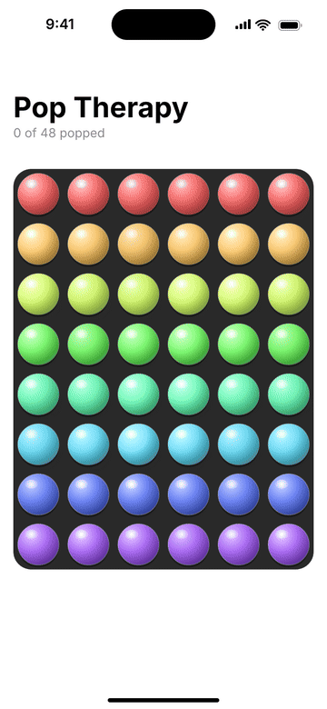
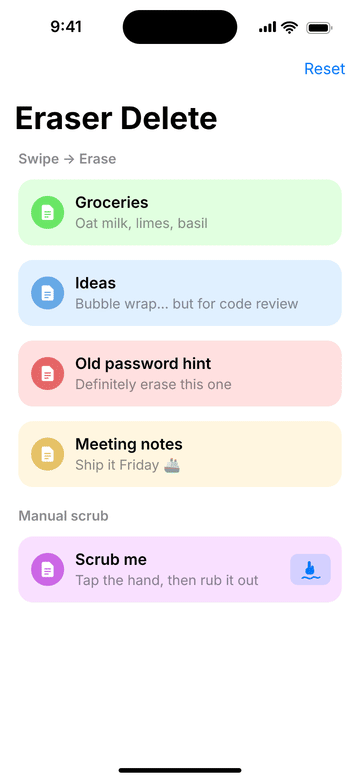
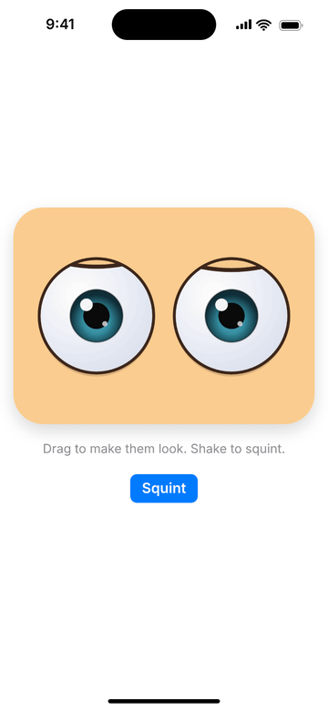
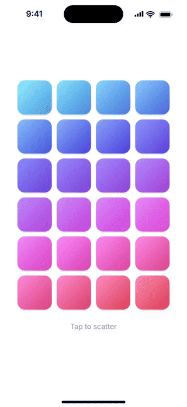
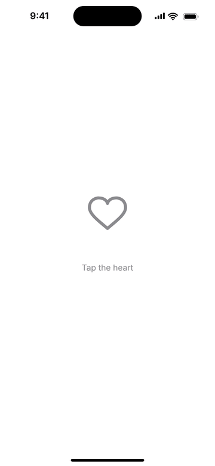
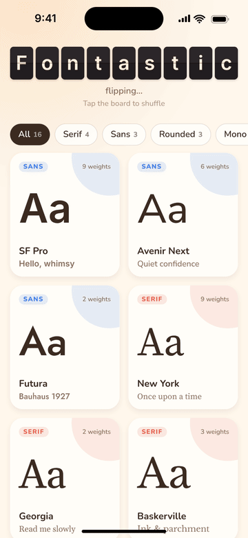

# whimsy-ui

Twelve small, tactile SwiftUI components, each with a pure-Swift, unit-tested core:

| | Component | What it does |
|---|---|---|
| 🫧 | **PopTherapy** | Bubble wrap: drag to pop, per-bubble squish, haptics, a gloss shader, and a gift when you finish. |
| 🧲 | **MagneticBeadSlider** | A slider whose beads trail the thumb like a magnetic chain, with squash, snapping and haptics. |
| 🩹 | **EraserDelete** | Delete a card by rubbing it out with a zig-zagging pink eraser, with crumbs. Automatic or manual scrub. |
| 📷 | **ShutterReveal** | A camera-iris reveal: metallic blades swirl open with overshoot and snap shut. |
| 👀 | **AliveEyes** | Two cartoon eyes with a spring gaze, saccades, asymmetric blinks and a shake-triggered squint. |
| 🧩 | **ScatterRegroup** | Tap a tile grid: tiles fling out tilted, then spring home in a ripple from the centre, ticking as they land. |
| ☀️ | **SolarFlareLike** | A like button: the heart pulses while curved, tapering flare ribbons erupt in a swirl. |
| 🚀 | **FlyingButton** | A capsule button that takes off when held: thrust plume, hover bob, shrinking shadow, soft landing. |
| 🎞️ | **GrainyRingGallery** | Photo cards on a 3D ring: drag with momentum and snap, depth blur, a hero detail view, and 12 fps Metal film grain. |
| 🧭 | **LiquidMetalCompass** | A liquid-chrome blob that leans and stretches toward a friend, wobbling on springs as you turn, with a dead-on haptic tick. |
| 🧶 | **SweaterRail** | A clothes rail that magnifies like the macOS Dock: garments spread, swell and swing on pendulums; tap one for a matched-geometry hero page, with a marquee ticker. |
| 🔤 | **FontCollection** | A font specimen gallery: a split-flap headline flips through 16 built-in faces and settles, category chips make the cards hop and regroup, and each card opens into a detail view. |

iOS 17+ / macOS 14+, Swift tools 6.0 (Swift 6 language mode).

> **Honest status:** every core target builds, and all 332 tests pass on Linux (Swift 6.4).
> The SwiftUI targets have **not yet been compiled or run on an Apple platform**. On Linux
> they compile to empty modules (`#if canImport(SwiftUI)`). They were checked with
> sourcekit-lsp (0 diagnostics), `swiftc -parse` and careful API review, but expect
> possible small fixes on the first Xcode build.
> The GIFs below are **HTML5 Canvas ports** of each view's drawing, running a JS port of
> the same core logic. They approximate the SwiftUI rendering; they are not device
> recordings. The FontCollection GIF also substitutes look-alike web fonts (e.g. Playfair
> Display for Didot, Libre Baskerville for Baskerville) for Apple's built-in families.

## Install (Swift Package Manager)

In Xcode: **File ▸ Add Package Dependencies…**, enter this repository's URL, and add the
products you want. Or in `Package.swift`:

```swift
dependencies: [
    .package(url: "https://github.com/<you>/whimsy-ui.git", from: "0.1.0"),
],
targets: [
    .target(name: "MyApp", dependencies: [
        .product(name: "ShutterReveal", package: "whimsy-ui"),
        .product(name: "AliveEyes", package: "whimsy-ui"),
    ]),
]
```

Each component is its own product: `PopTherapy`, `MagneticBeadSlider`, `EraserDelete`,
`ShutterReveal`, `AliveEyes`, `ScatterRegroup`, `SolarFlareLike`, `FlyingButton`, `GrainyRingGallery`, `LiquidMetalCompass`, `SweaterRail` and `FontCollection`. There's also a SwiftUI-free `…Core` product for each
(e.g. `ShutterRevealCore`), plus `WhimsyGallery`, a demo list of all twelve.

```swift
import WhimsyGallery
WhimsyGallery()   // NavigationStack listing every component with a live demo
```

---

### 🫧 PopTherapy



```swift
import PopTherapy

PopTherapyView()                    // 6 × 8 sheet
PopTherapyView(columns: 5, rows: 7)
```

- **Popping:** drag to pop. Fast drags interpolate, so no bubble is skipped.
- **Feel:** each pop squishes and gives a light haptic of random intensity. A Metal
  `.colorEffect` shader drifts a gloss highlight across the sheet.
- **Finish:** popping everything unwraps a gift, with a Reset button.

### 🧲 MagneticBeadSlider


```swift
import MagneticBeadSlider

@State private var value = 0.4
MagneticBeadSlider(value: $value, steps: 10)   // stepped; snaps on release
MagneticBeadSlider(value: $value, steps: 0)    // continuous
```

- **Motion:** eight beads follow the thumb with distance-falloff pull and per-bead damped
  springs, squashing along their motion.
- **Haptics:** selection feedback on step crossings, and an impact on snap.

### 🩹 EraserDelete



```swift
import EraserDelete

NoteCard(note)
    .eraserDelete(isErasing: $isErasing) {
        withAnimation { notes.removeAll { $0.id == note.id } }
    }
// or ErasableCard(isErasing:style: .manual, onErased:) { … } to scrub by hand
```

- **Masking:** the card is masked by the growing stroke (`.destinationOut`).
- **Feel:** a haptic on each zig-zag turn, and crumbs fall off the eraser.
- **Finish:** at 96% coverage the remains fade and `onErased` fires.

### 📷 ShutterReveal


```swift
import ShutterReveal

PhotoView()
    .shutterRevealOnTap(isOpen: $isOpen)            // or .shutterReveal(isOpen:blades:response:)
    .clipShape(.rect(cornerRadius: 28))             // after the modifier, so it clips the blades too
```

- **Coverage:** blade *j* is the wedge outside the aperture polygon at vertex *j*, so the
  blades tile the outside exactly. The tests verify full coverage when closed and full
  clearance when open.
- **Motion:** opening is a springy overshoot, and the content scales 0.96 → 1. Closing
  snaps, with a light haptic as the blades shut. Fast motion adds rotated ghost copies as
  motion blur.

### 👀 AliveEyes



```swift
import AliveEyes

AliveEyesView(lidColor: face, squintTrigger: squints)
    .frame(height: 260)
    .background(face, in: .rect(cornerRadius: 36))
```

Timings follow Matt Busel's ["Making two cartoon eyes feel alive"](https://dev.to/mattbusel/making-two-cartoon-eyes-feel-alive-springs-saccades-and-blinks-in-swiftui-26i9):

- Gaze spring k 420 / ζ 0.8, drifting home on release.
- Saccades every 0.25–0.9 s.
- Blinks every 2.2–6.5 s, 70 ms close / 100 ms open, 18% double blinks.
- Shake (Core Motion, iOS) to squint; double-tap or `squintTrigger` elsewhere.

### 🧩 ScatterRegroup



```swift
import ScatterRegroup

ScatterRegroupGrid()                                  // 4 × 6, tap to toggle
ScatterRegroupGrid(columns: 3, rows: 4, seed: 7, isScattered: $isScattered)
```

- **Scatter:** each tile flies to a random spot, tilted up to ±25° and scaled 0.86–1.14.
  Targets are inset by the tile's half-diagonal, so a tilted tile never leaves the bounds.
- **Springs:** every tile has its own stiffness (150 × 0.7–1.3, fixed per seed) at damping
  0.62, so they arrive at slightly different times with a little bounce.
- **Regroup:** delays grow with distance from the centre (0 → 0.38 s), giving a ripple
  outward. Each tile reports its landing once, and a light haptic ticks at most every
  50 ms, so a burst of landings doesn't blur together.

> **Stagger alternative:** if you'd rather express the ripple with SwiftUI's own
> animations instead of a simulated spring per tile, jazzychad's
> [AnimationSequencing](https://github.com/jazzychad/AnimationSequencing) choreographs
> SwiftUI animations into ordered sequences of steps. It isn't a dependency here: the core does its own staggering so
> it stays deterministic and testable on Linux.

### ☀️ SolarFlareLike



```swift
import SolarFlareLike

@State private var isLiked = false
SolarFlareLikeButton(isLiked: $isLiked)               // 44 pt heart
SolarFlareLikeButton(isLiked: $isLiked, size: 72, label: Text("Like post"))
```

- **Like:** the heart pulses 1 → 1.25 → 1 on a spring, and 7–9 flare ribbons launch in
  random order over 120 ms. The ribbons share one swirl direction, and each tapers to a
  point.
- **Ribbon motion:** each ribbon's tip follows a closed-form spring (ω 22, ζ 0.55), with the
  tail 160 ms behind. So a ribbon shoots out, detaches and shrinks away as it fades over
  0.62 s, colored gold → orange → magenta.
- **Unlike:** a quick shrink to 0.8, with no flare.
- **Haptics:** a light haptic fires on like only.
- **Room to draw:** the flare draws outside the button (a centred square 2.6× its size) and
  never intercepts touches.

### 🚀 FlyingButton


```swift
import FlyingButton

FlyingButton("Launch") { launch() }        // a tap calls the action as usual
```

- **Press and hold:** the capsule crouches for ~0.15 s while the engine spools up (thrust),
  then springs up to ~24 pt and hovers with a gentle 1.1 Hz bob (airborne). Its contact
  shadow shrinks and fades as it rises.
- **Release:** it floats down on a soft spring, touches down with a tiny (~1 pt) bounce and
  goes idle. Releasing during the spool-up just settles without taking off.
- **Plume:** a seeded particle emitter under the capsule (140 puffs/s during thrust, 70/s
  while hovering, a short puff on landing). Puffs shoot down and outward, skid along the
  ground, rise as they cool and fade from ember yellow → orange → warm smoke.
- **Haptics:** a medium impact at liftoff and a light one at touchdown.
- **Room to draw:** the plume and shadow draw behind and below the capsule (a 200 × 96 pt
  area) and never intercept touches.

### 🎞️ GrainyRingGallery


```swift
import GrainyRingGallery

GrainyRingGallery(cards: RingPhotoCard.samples)        // 8 gradient "photo" cards + captions

GrainyRingGallery(cards: albums, grain: 0.15,           // your own cards
                  accessibilityTitle: { $0.title }) { album in
    AlbumCover(album)
} detail: { album in                                    // shown under the enlarged card
    TrackList(album)
}
```

- **Ring:** card *i* sits at *i* · 360°/N. Its angle sets the x offset (radius 140 pt), a
  rise towards the back (46 pt), and a yaw of up to 52° so side cards face outwards (via
  `rotation3DEffect`). Depth (`(cos θ + 1) / 2`) drives the rest: scale 1 → 0.52, opacity
  1 → 0.32, blur 0 → 5 pt and `zIndex`. The yaw eases back to 0 behind, so no card shows
  its back.
- **Drag:** 120 pt of drag turns the ring by one card, and it follows your finger. On release
  it coasts on the fling velocity with exponential friction (4/s, capped at 14 cards/s).
  Below 1.6 cards/s a spring (k 150, ζ 0.86) settles it onto the card nearest the projected
  stop. Touching a spinning ring catches it dead.
- **Detail:** tap the front card and it grows into a detail view via
  `matchedGeometryEffect`, with your `detail` content below it; tap ✕ or the backdrop to
  close. Tapping a side card turns it to the front the short way round. A selection haptic
  ticks as each card passes the front.
- **Grain:** a Metal `[[stitchable]]` `colorEffect` (`Resources/FilmGrain.metal`) adds
  monochrome grain that's strongest in the midtones. It's driven by
  `TimelineView(.periodic(by: 1/12))`. The core quantises time to 12 fps and hashes each
  frame into a seed, so the grain jumps like projected film rather than crawling like static.
  The gallery paints its own dark backdrop so the grain covers the whole view.
- **Core:** `RingGalleryModel` (placement, drag/momentum/snap, `step(by:)`, `select(_:)`,
  `frontIndex`, `grainFrame(at:)` / `grainSeed(at:)`) is plain Swift and fully tested.

### 🧭 LiquidMetalCompass


```swift
import LiquidMetalCompass

LiquidMetalCompass(friendName: "Maya", friendBearing: 62, distance: 1_240)
LiquidMetalCompass(friendName: "Maya", friend: maya, from: me, units: .imperial) // great-circle
LiquidMetalCompass(friendBearing: 62, headingSource: ManualHeadingSource())        // your own sensor
```

- **Pointing:** the friend's bearing is fixed in the world. The blob leans toward
  *bearing − heading*, always the short way round (350° → 10° is +20°), on an underdamped
  spring (k 70, ζ 0.38, ~27% overshoot), so every turn swings past and wobbles back.
- **Stretch:** a second, bouncier spring (k 140, ζ 0.28) sets the stretch: 0.42 at rest,
  up to +0.32 more while swinging fast (full at 240°/s), so the liquid flings out and
  jiggles as it settles. The outline is a circle with a rounded cos-power lobe toward the
  friend; the far side pulls in, the centre leans, and the area is renormalised so the
  liquid's volume never changes.
- **Chrome:** the blob is drawn as a dome-shaped height field and blurred. A Metal
  `[[stitchable]]` `layerEffect` (`Resources/LiquidChrome.metal`, loaded with
  `ShaderLibrary.bundle(.module)`) cuts a crisp metaball edge, derives normals and reflects
  a studio (sky, dark floor, horizon line, two softboxes). The studio turns with the
  heading, like a real metal object reflecting a fixed room. A tick dial turns with the
  heading too, so north stays north.
- **Dead on:** within 4° you're aligned (and stay aligned until 8°: hysteresis). Each new
  alignment plays a soft haptic (`.impact(flexibility: .soft)`), at most every 0.35 s; the
  blob glows warm and the caption reads "Dead ahead".
- **Distance:** shown with `.contentTransition(.numericText(value:))`, rounded per band
  (1 m < 100 m, 10 m < 1 km, 0.1 km < 10 km; imperial uses ft, then 0.1 mi).
- **Heading:** behind a `HeadingSource` protocol. `HeadingSources.automatic()` picks
  `MotionHeadingSource` (CMMotionManager, north-referenced attitude, 60 Hz), falling back
  to `LocationHeadingSource` (CLLocationManager; true north when location access is
  granted, magnetic otherwise). In previews, the simulator or on a Mac, **drag sideways to
  fake the heading** (0.5°/pt, dragging right turns right).

### 🧶 SweaterRail


```swift
import SweaterRail

SweaterRail()                                     // five sample knits drawn from shapes
SweaterRail(garments: myKnits, brand: "Loop", ticker: "FREE RETURNS  ✦  ")
```

- **Dock falloff:** each garment's magnification is a raised cosine of its distance from the
  finger (1.5× directly under it, fading to 1× at 150 pt). Widths grow with the scale and the
  row is re-anchored so the point under your finger stays under it, so neighbours are pushed
  apart on both sides, exactly like the Dock. The hovered garment also drops 6 pt forward,
  its wall shadow grows and softens, and a selection haptic ticks as you move between items.
- **Springs and swing:** every hook rides a lively spring (k 260, ζ 0.72). Each garment hangs
  from its hook on a damped pendulum driven by the hook's own acceleration
  (θ'' = −(g/L)·sin θ − (a/L)·cos θ − cθ', L 110 pt, period ≈ 0.93 s), so a spread
  sets the whole rail swinging and it rocks to rest.
- **Hero:** tap a garment and it flies to a detail page with `matchedGeometryEffect`, while
  the rest slide off left and right on staggered springs (neighbours first, 40 ms apart). ✕
  sends it back.
- **Marquee:** a ticker scrolls along the bottom at 40 pt/s, wrapping seamlessly with just
  enough copies to cover the width.
- **Core:** `DockFalloff`, `RailLayout`, `Pendulum`, `SweaterRailModel`, `RailExit` and
  `Marquee` are plain Swift and fully tested. The springs come from the shared
  `WhimsySpring` in WhimsyCore.

### 🔤 FontCollection



```swift
import FontCollection

FontCollection()                                    // 16 built-in faces, "Fontastic" on the flip board
FontCollection(headline: "Hello", seed: 68)         // your own word; a fixed seed fixes the flip sequence
FontCollection(fonts: FontCatalog.standard.specimens.filter { $0.category != .script })
```

- **Fonts:** only faces that ship with iOS 17 and macOS 14; no font files are bundled. The
  four system designs (SF Pro, New York, SF Rounded, SF Mono) plus Avenir Next, Futura,
  Georgia, Baskerville, Rockwell, Chalkboard SE, Marker Felt, Menlo, American Typewriter,
  Didot, Copperplate and Snell Roundhand, via `Font.custom(_:fixedSize:)` by family name.
  Each specimen has a category (serif, sans, rounded, mono, display, script), a sample
  phrase, a note and the weights the family really has. If a family is missing on a device
  (checked once with Core Text), the category's system design stands in.
- **Flip board:** the headline is a row of split-flap cells. It flaps through 14 seeded
  random fonts (no repeats, the target only at the end), with gaps easing from 50 ms to
  260 ms (ease-in, exponent 2.6). Each flap's top half folds down and the bottom half lands
  (`rotation3DEffect`), and the cells follow column 0 28 ms apart, so each flap runs across
  the word like a wave. The final flap falls 1.8× slower, then "set in Didot" pops in.
  Tap the board to shuffle to another font.
- **Haptics (iOS):** a light tick per flap that grows stronger as the board slows
  (intensity 0.3 → 0.8), a firmer impact when it lands, a soft tick as each card lands after
  a filter change, selection ticks on chips and weight detents. The core rate-limits them
  to one per 40 ms (the settle always plays).
- **Chips & regroup:** All · Serif · Sans · Rounded · Mono · Display · Script, with counts.
  The selected pill slides (`matchedGeometryEffect`) and the row scrolls it into view.
  Cards that stay visible fly to their new slot on a closed-form spring (response 0.52 s,
  ζ 0.72), hopping on an arc (0.12 pt per pt travelled, ≤ 36 pt) with a seeded tilt of up to
  ±9°, staggered 45 ms per slot so they land in reading order. Newcomers grow in from below;
  leavers shrink and fade in 0.24 s.
- **Detail:** tap a card and it grows into a detail view (`matchedGeometryEffect`) with
  editable sample text (≤ 80 characters; empty shows the pangram), a size slider (18–120 pt),
  a weight slider with one detent per real weight, and an 80-glyph strip (A–Z, a–z, 0–9,
  punctuation). Tap ✕ or the backdrop to close.
- **Core:** `FontCatalog` (filter/sort/search), `FlipBoardSchedule`, `SpecimenGridLayout`
  + `RegroupPlan` (flights, poses, landing times), `SpecimenDetailState`, `HapticGate`, and
  `FontCollectionModel`, which ties them together and returns due haptics from `step(_:)`.
  All plain Swift and fully tested (42 tests).

---

## Accessibility

Every component handles **Reduce Motion**, each in its own way:

| Component | With Reduce Motion |
|---|---|
| PopTherapy | No gloss drift or squish. |
| MagneticBeadSlider | Beads settle instantly. |
| EraserDelete | Quick fade. |
| ShutterReveal | Crossfade. |
| AliveEyes | No saccades, gentler blinks. |
| ScatterRegroup | Crossfade between the grid and the scattered layout. |
| SolarFlareLike | No ribbons or pulse; the heart's fill/colour change crossfades. |
| FlyingButton | No lift or plume; holding fades the capsule to 55% opacity instead. |
| GrainyRingGallery | No momentum (releases snap straight to the nearest card), the detail view crossfades instead of zooming, and the grain is frozen. |
| LiquidMetalCompass | Critically damped turn (no overshoot or wobble), no swing stretch, static reflections, and the distance changes without rolling. |
| SweaterRail | No pendulum swing, critically damped spreading (no overshoot), the marquee stands still, and the hero page opens with a short ease instead of a bouncy spring. |
| FontCollection | The flip board shows its font straight away (no flapping), filter changes crossfade cards in place, and the detail view crossfades instead of zooming. |

All twelve have VoiceOver labels and actions (e.g. pop next bubble, adjustable slider,
erase, open/close shutter, squint, scatter/regroup, and a like toggle with the toggle trait and a Liked / Not liked value; FlyingButton is a plain button with its title as the label; GrainyRingGallery is adjustable (swipe up/down steps cards, value "Dunes, 1 of 8") with an Open action, and its detail view is modal with a Close button and the escape gesture; LiquidMetalCompass reads e.g. "Compass to Maya: 30° to your right, 1.2 kilometres", and is adjustable by 15° when faking the heading; SweaterRail exposes each garment as a button ("Cobalt Cardigan, $146") that opens its page, which is modal with a Close button and the escape gesture; FontCollection's flip board reads "Fontastic, set in Didot" with a shuffle action, chips carry the selected trait and a font count, each card is a button ("Didot, Display") and the detail view is modal with a Close button and the escape gesture).

## Layout

```
Sources/
  WhimsyCore/            Shared Vec2, SeededRandom (SplitMix64), WhimsySpring and WhimsyMath, re-exported by the cores
  PopTherapyCore/        PopTherapy/          (+ Resources/Shaders.metal)
  MagneticBeadCore/      MagneticBeadSlider/
  EraserDeleteCore/      EraserDelete/
  ShutterRevealCore/     ShutterReveal/
  AliveEyesCore/         AliveEyes/
  ScatterRegroupCore/    ScatterRegroup/
  SolarFlareCore/        SolarFlareLike/
  FlyingButtonCore/      FlyingButton/
  RingGalleryCore/       GrainyRingGallery/   (+ Resources/FilmGrain.metal)
  LiquidCompassCore/     LiquidMetalCompass/  (+ Resources/LiquidChrome.metal)
  SweaterRailCore/       SweaterRail/
  FontCollectionCore/    FontCollection/
  WhimsyGallery/         Demo gallery of all twelve
Tests/                   Swift Testing suites for WhimsyCore and every core
docs/                    README GIFs
```

The `…Core` targets import only Foundation and are deterministic (seedable RNGs, fixed
substeps), so they test on any platform:

```sh
swift build && swift test     # Linux or macOS
```

## License

MIT © 2026 Gurinder Singh. See [LICENSE](LICENSE).
