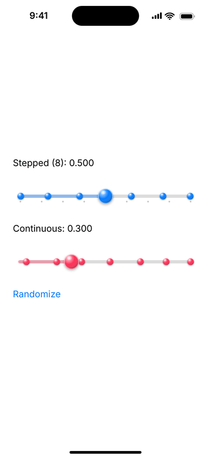
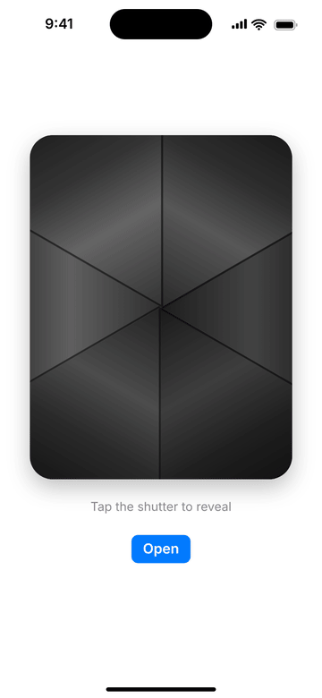

# whimsy-ui

Five small, tactile SwiftUI components, each with a pure-Swift, unit-tested core:

| | Component | What it does |
|---|---|---|
| 🫧 | **PopTherapy** | Bubble wrap: drag to pop, per-bubble squish, haptics, a gloss shader, and a gift when you finish. |
| 🧲 | **MagneticBeadSlider** | A slider whose beads trail the thumb like a magnetic chain, with squash, snapping and haptics. |
| 🩹 | **EraserDelete** | Delete a card by rubbing it out with a zig-zagging pink eraser, with crumbs. Automatic or manual scrub. |
| 📷 | **ShutterReveal** | A camera-iris reveal: metallic blades swirl open with overshoot and snap shut. |
| 👀 | **AliveEyes** | Two cartoon eyes with a spring gaze, saccades, asymmetric blinks and a shake-triggered squint. |

iOS 17+ / macOS 14+, Swift tools 6.0 (Swift 6 language mode).

> **Honest status:** every core target builds, and all 143 tests pass on Linux (Swift 6.4).
> The SwiftUI targets have **not yet been compiled or run on an Apple platform**. On Linux
> they compile to empty modules (`#if canImport(SwiftUI)`). They were checked with
> sourcekit-lsp (0 diagnostics), `swiftc -parse` and careful API review, but expect
> possible small fixes on the first Xcode build.
> The GIFs below are **HTML5 Canvas ports** of each view's drawing, running a JS port of
> the same core logic. They approximate the SwiftUI rendering; they are not device
> recordings.

## Install (Swift Package Manager)

In Xcode: **File ▸ Add Package Dependencies…**, enter this repository's URL, and add the
products you want. Or in `Package.swift`:

```swift
dependencies: [
    .package(url: "https://github.com/<you>/whimsy-ui.git", from: "0.1.0"),
],
targets: [
    .target(name: "MyApp", dependencies: [
        .product(name: "ShutterReveal", package: "whimsy-ui"),
        .product(name: "AliveEyes", package: "whimsy-ui"),
    ]),
]
```

Each component is its own product: `PopTherapy`, `MagneticBeadSlider`, `EraserDelete`,
`ShutterReveal` and `AliveEyes`. There's also a SwiftUI-free `…Core` product for each
(e.g. `ShutterRevealCore`), plus `WhimsyGallery`, a demo list of all five.

```swift
import WhimsyGallery
WhimsyGallery()   // NavigationStack listing every component with a live demo
```

---

### 🫧 PopTherapy


```swift
import PopTherapy

PopTherapyView()                    // 6 × 8 sheet
PopTherapyView(columns: 5, rows: 7)
```

- **Popping:** drag to pop. Fast drags interpolate, so no bubble is skipped.
- **Feel:** each pop squishes and gives a light haptic of random intensity. A Metal
  `.colorEffect` shader drifts a gloss highlight across the sheet.
- **Finish:** popping everything unwraps a gift, with a Reset button.

### 🧲 MagneticBeadSlider



```swift
import MagneticBeadSlider

@State private var value = 0.4
MagneticBeadSlider(value: $value, steps: 10)   // stepped; snaps on release
MagneticBeadSlider(value: $value, steps: 0)    // continuous
```

- **Motion:** eight beads follow the thumb with distance-falloff pull and per-bead damped
  springs, squashing along their motion.
- **Haptics:** selection feedback on step crossings, and an impact on snap.

### 🩹 EraserDelete


```swift
import EraserDelete

NoteCard(note)
    .eraserDelete(isErasing: $isErasing) {
        withAnimation { notes.removeAll { $0.id == note.id } }
    }
// or ErasableCard(isErasing:style: .manual, onErased:) { … } to scrub by hand
```

- **Masking:** the card is masked by the growing stroke (`.destinationOut`).
- **Feel:** a haptic on each zig-zag turn, and crumbs fall off the eraser.
- **Finish:** at 96% coverage the remains fade and `onErased` fires.

### 📷 ShutterReveal



```swift
import ShutterReveal

PhotoView()
    .shutterRevealOnTap(isOpen: $isOpen)            // or .shutterReveal(isOpen:blades:response:)
    .clipShape(.rect(cornerRadius: 28))             // after the modifier, so it clips the blades too
```

- **Coverage:** blade *j* is the wedge outside the aperture polygon at vertex *j*, so the
  blades tile the outside exactly. The tests verify full coverage when closed and full
  clearance when open.
- **Motion:** opening is a springy overshoot, and the content scales 0.96 → 1. Closing
  snaps, with a light haptic as the blades shut. Fast motion adds rotated ghost copies as
  motion blur.

### 👀 AliveEyes


```swift
import AliveEyes

AliveEyesView(lidColor: face, squintTrigger: squints)
    .frame(height: 260)
    .background(face, in: .rect(cornerRadius: 36))
```

Timings follow Matt Busel's ["Making two cartoon eyes feel alive"](https://dev.to/mattbusel/making-two-cartoon-eyes-feel-alive-springs-saccades-and-blinks-in-swiftui-26i9):

- Gaze spring k 420 / ζ 0.8, drifting home on release.
- Saccades every 0.25–0.9 s.
- Blinks every 2.2–6.5 s, 70 ms close / 100 ms open, 18% double blinks.
- Shake (Core Motion, iOS) to squint; double-tap or `squintTrigger` elsewhere.

---

## Accessibility

Every component handles **Reduce Motion**, each in its own way:

| Component | With Reduce Motion |
|---|---|
| PopTherapy | No gloss drift or squish. |
| MagneticBeadSlider | Beads settle instantly. |
| EraserDelete | Quick fade. |
| ShutterReveal | Crossfade. |
| AliveEyes | No saccades, gentler blinks. |

All five have VoiceOver labels and actions (e.g. pop next bubble, adjustable slider,
erase, open/close shutter, squint).

## Layout

```
Sources/
  WhimsyCore/            Shared Vec2 + SeededRandom (SplitMix64), re-exported by the cores that use them
  PopTherapyCore/        PopTherapy/          (+ Resources/Shaders.metal)
  MagneticBeadCore/      MagneticBeadSlider/
  EraserDeleteCore/      EraserDelete/
  ShutterRevealCore/     ShutterReveal/
  AliveEyesCore/         AliveEyes/
  WhimsyGallery/         Demo gallery of all five
Tests/                   Swift Testing suites for WhimsyCore and every core
docs/                    README GIFs
```

The `…Core` targets import only Foundation and are deterministic (seedable RNGs, fixed
substeps), so they test on any platform:

```sh
swift build && swift test     # Linux or macOS
```

## License

MIT © 2026 Gurinder Singh. See [LICENSE](LICENSE).
