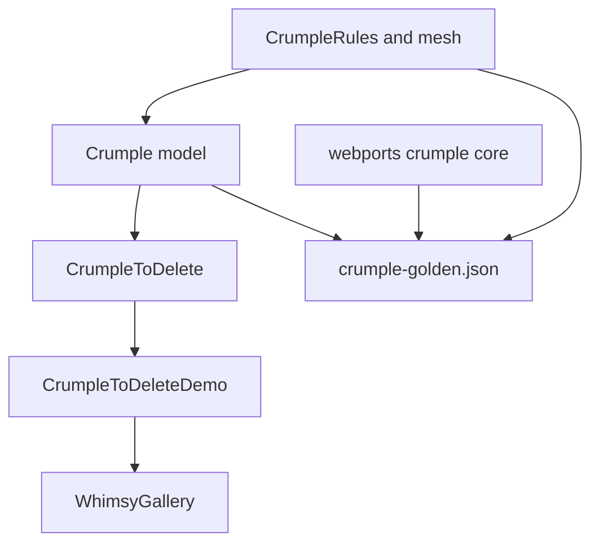
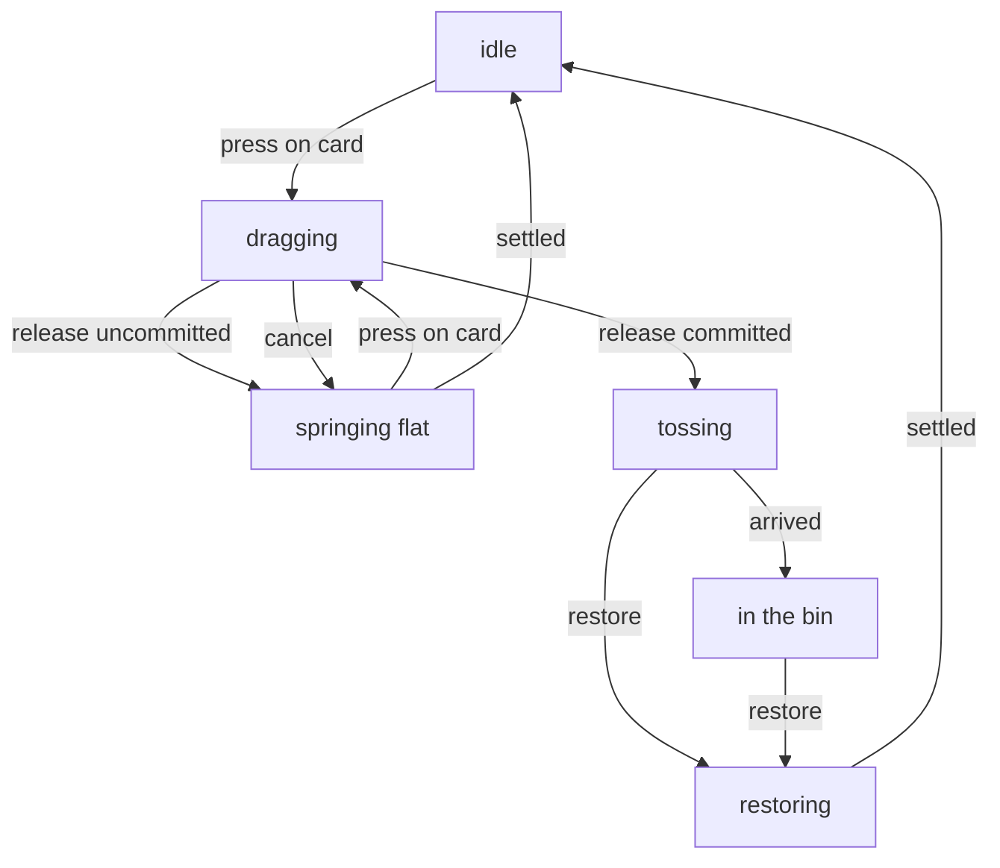

# CrumpleToDelete - Plan

## Goal Capsule

- **Objective:** A person can drag a card toward the trash and watch it crumple into a ball that lands in the bin, then undo and try again. Someone using VoiceOver can delete the card without dragging. Someone who prefers less motion still deletes the card, by a fade and shrink.
- **Means:** A deterministic Swift core and a SwiftUI card, registered as component 37 from current main, with an HTML preview that uses the same constants (KTD1, KTD2, KTD6).
- **Authority:** Requirements win on behavior. Key technical decisions win on mechanism. Assumptions fill the gaps the request left open; the implementer follows them.
- **Execution:** code. Ship an open pull request. Do not merge it.
- **Stop:** Do not modify or merge pull requests 1, 2, or 3. Do not add or search for XRayDevice. It has no path in this repository.
- **Who finishes:** The implementer opens the pull request and reports its URL, test counts, the public API, caveats, and the preview artifact paths.

## Product Contract

### Summary

Add CrumpleToDelete to the gallery. Dragging the card toward a trash icon crumples it into about 40 shaded triangles. Letting go past the commit line, or after the card has entered the bin and stayed there, snaps it into a ball and tosses it in. Letting go earlier springs it flat. The demo can restore the card.

### Problem Frame

The gallery's delete interactions erase, peel, or fade. None of them crumples a card into a paper ball and drops it in a bin, and none of them can be replayed from an undo on that same card. The package already separates a pure-Swift core from a SwiftUI view, which is what makes the crumple testable on Linux and previewable in HTML.

### Key Decisions

- Commit on release. Governs R1, R2. Entering the bin arms the delete. The snap waits until the finger lifts, so a drag that only brushes the bin can still spring flat.
- Resting face is the caller's view. Governs R5. The triangles are a generated paper mesh. They do not sample the wrapped view.

### Requirements

**Gesture**

- R1. Releasing the card before it is committed springs it back to flat.
- R2. Releasing the card commits the delete when progress is at least 0.8, or when the card has entered the bin and has not left it. A commit snaps the card into a ball with a small spring bounce, tosses the ball in an arc into the bin, and the lid can bump.
- R3. The demo can undo a delete and restore the card so the gesture can be played again.

**Picture**

- R4. The crumple is about 40 triangle facets drawn in a Canvas. From progress 0 to 1, each facet normal tilts from a fixed seed, a fixed light shades the facets, and the vertices pull toward the center.
- R5. The public view wraps arbitrary content as the card people see while it is flat, and the gallery includes a demo.

**Feedback and access**

- R6. Each new crease emits one core event per gesture. The haptic is a light tick, and playback is rate-limited.
- R7. VoiceOver offers a delete action that commits without a drag.
- R8. Reduce Motion fades and shrinks the card instead of crumpling it, and uses the same commit rule as R2.

**Gallery and proof**

- R9. The component is registered in the gallery, the README, and a spec, numbered from actual current main. Pull requests 1, 2, and 3 stay untouched.
- R10. An HTML Canvas approximation uses the same core constants. A parity check compares Swift and JavaScript. A preview GIF and a stills contact sheet are produced. Linux core tests and syntax parsing are reported separately from Apple-platform build and runtime.

### Key Flows

- F1. Drag and release
  - **Trigger:** A finger presses the resting card and moves toward the trash.
  - **Steps:** Progress follows the finger. Creases emit while the crumple deepens. Release applies R1 or R2.
  - **Outcome:** The card is flat, or the ball is in the bin.
  - **Covered by:** R1, R2, R4, R6
- F2. Undo
  - **Trigger:** The demo's restore control, including during the toss.
  - **Steps:** The card returns. An arrival that has not happened yet does not fire.
  - **Outcome:** The card is flat and can be dragged again.
  - **Covered by:** R3
- F3. Delete without dragging
  - **Trigger:** The VoiceOver delete action, or Reduce Motion with the same drag.
  - **Steps:** The commit rule in R2 still decides a drag. The action commits immediately from rest. The picture follows R8 when Reduce Motion is on.
  - **Outcome:** VoiceOver delete commits without a drag and still snaps and tosses, unless Reduce Motion is on. A Reduce Motion drag commits only under R2, then fades and shrinks. An uncommitted Reduce Motion drag springs the card back.
  - **Covered by:** R7, R8

### Acceptance Examples

- AE1. Release at progress 0.79 with the card outside the bin springs flat. Covers R1.
- AE2. Release at progress 0.8 outside the bin snaps, tosses, and the lid can bump. Covers R2.
- AE3. The card enters the bin below progress 0.8 and is released while still inside. It commits. Covers R2.
- AE4. The card enters the bin, then leaves it, and is released below 0.8. It springs flat. Covers R1, R2.
- AE5. An edge that folds, flattens, and folds again in one drag emits one crease event. Covers R6.
- AE6. VoiceOver delete from rest commits without a drag. Covers R7.
- AE7. With Reduce Motion on, a commit fades and shrinks and does not draw the mesh, toss a ball, or bump the lid. Covers R8.
- AE8. Restore before the ball arrives returns the card and does not report the delete. Covers R3.

### Success Criteria

- The core tests pass on Linux, and the pull request states that those tests do not prove the SwiftUI view.
- The parity script exits successfully against the checked-in golden trace.
- The GIF and the contact sheet exist for review.
- The pull request is open and unmerged.

### Scope Boundaries

- One card and one bin in the demo. The reusable view does not own a list of notes.
- The wrapped content is visible while the card is flat. It is not painted onto the triangles.
- This branch adds a web port only for CrumpleToDelete. It does not restore the ports the README already names.
- XRayDevice is out of scope. It is not in this repository.

#### Deferred to Follow-Up Work

- Rasterizing the wrapped view into the facet mesh, if an Apple-only snapshot is ever worth a path Linux cannot test.
- Renumbering if another open pull request that also claims 34 merges first.
- Putting the historical `webports/` pages back on main.

### Sources

- `origin/main` at `5325649` ends at HoldToFanDock, the 33rd gallery case in `Sources/WhimsyGallery/WhimsyGallery.swift`. Pull requests 1, 2, and 3 each already call themselves 34.
- `Sources/DogEarCore/DogEarLayout.swift` and `Sources/DogEarCore/DogEarModel.swift` supply the release latch, `WhimsySpring` values, and the 0.12 s haptic gap.
- `Sources/ColorFigureCore/FigureInk.swift` fixes the light at `(0.45, 0.55, 0.70)`. `FigureRender.drawSolid` uses that dot only to pick a three-tone ink. `Sources/ColorFigureGumball/ColorFigureGumball.swift` is the Canvas fill. The crumple shade is the Lambert term in A7, on one paper color, with no hatch.
- `Sources/EraserDelete/EraserDelete.swift` and `Sources/ClothPoster/ClothPoster.swift` wrap arbitrary content as a live view. Nothing in the package snapshots a view into a Canvas.
- `Sources/WhimsyCore/SeededRandom.swift` documents `uniform` as the bit-stable helper. `double(in:)` is not.
- `README.md` is the spec on main. There is no `specs/` directory, no `webports/` tree, and no CI workflow. The Accessibility section still says "All twenty-one" above a table of 33 rows.

## Planning Contract

### Key Technical Decisions

- KTD1. `CrumpleCore` depends only on `WhimsyCore` and holds its own three-component vector. `CrumpleToDelete` is the SwiftUI product. The view file is wrapped in `#if canImport(SwiftUI)`, with no Metal resources. The mesh is 5 by 4 quads, two triangles each, 40 triangles. Tilt amplitude scales with progress. Vertices pull toward the centroid until they lie on a ball whose radius is one sixth of the card's shorter side. Drag progress clamps to 0...1. The commit snap may overshoot that radius briefly, then settle on it, so the bounce is a ball and not a point. Seeded draws use `SeededRandom.uniform`.
- KTD2. The gallery number is 37. Append `crumpleToDelete` after RubberBandCardHand. Pull requests 1, 2, and 3 landed first as 34, 35, and 36.
- KTD3. Finger-up reads the current progress and the zone latch. Progress at or above 0.8 commits. The zone latch sets when the card center enters the bin rect and clears when the center leaves that rect. There is no second progress threshold at 0.77 and no outset. Crossing the bin does not snap while the finger is down, because that would make R1 false for any drag that touched the bin.
- KTD4. The core appends each crease id once per gesture and keeps that log. The view plays at most one light impact per 0.12 s by coalescing playback. It does not delete log entries to keep the gap. Cloth and DogEar drop ticks that arrive inside the interval. That drop would fail R6.
- KTD5. Mesh opacity is progress and the wrapped view's opacity is 1 minus progress. Reduce Motion does not draw the mesh. The gallery shows a demo type that owns the sample card, the bin, and the undo control. The reusable view takes the caller's content and reports deletion. It does not remove that content.
- KTD6. Constants and the golden trace live in the core and in `webports/crumple-golden.json`. JavaScript copies the mesh and the gesture rules and must use the SplitMix64 `uniform` formula, not `double(in:)`. `webports/crumple-parity.mjs` fails if JavaScript drifts from the golden file. The Swift parity test fails if the core drifts from the same file. Commit `docs/crumple.gif` for the README. Also copy the GIF and a stills contact sheet to the agent artifacts directory. Do not restore older ports.
- KTD7. README gains the component section, the table row, the accessibility row, and the layout count moves from thirty-three to thirty-seven. The Accessibility sentence that says "All twenty-one" becomes "All thirty-seven" so it matches the table. Add `specs/37-crumple-to-delete.md` because R9 asks for a spec even though main has none. Do not add `tools/`.

### High-Level Technical Design

The core owns the mesh and the gesture. The view draws, plays haptics, and reads accessibility settings. The HTML page repeats the core. The golden file is the shared expected output.



Release is the only commit edge. Restore can interrupt a toss.



Reduce Motion uses the same edges. Tossing is drawn as a fade and shrink, and the lid does not bump.

### Assumptions

These bets were not confirmed in the request. Follow them.

- A1. Progress is the finger's projection from the card's rest center toward the bin center, divided by that gap, and clamped to 0...1. It falls when the finger moves back. It is not a high-water mark.
- A2. A crease is one shared triangle edge. During a drag, when progress is increasing, an edge emits once its fold angle crosses 0.35 radians if that edge is not already in the gesture set. A single step emits every edge it crosses. The set clears when a gesture begins. Spring-back and the toss emit nothing.
- A3. The delete callback fires once, when the ball arrives or the Reduce Motion fade ends. Restore before that suppresses it and skips the lid bump. The view keeps its content for the whole life of the view.
- A4. A system cancel springs the card flat. A new drag during spring-back is allowed, inherits progress, and clears the zone latch and the crease set. A drag during the toss, while the card is in the bin, or while it is restoring, is ignored.
- A5. The VoiceOver action commits immediately from idle, dragging, or springing flat. During the toss, after arrival, and while restoring, it does nothing.
- A6. A bin with zero width or zero height never sets the zone latch.
- A7. The light is `(0.45, 0.55, 0.70)`, normalized. Shade is a Lambert term on one paper color. The demo seed is 34. The same seed and progress redraw the same vertices and colors.
- A8. Spring-back uses stiffness 380 and damping ratio 0.4, copied from `DogEarRules`. Reduce Motion spring-back uses stiffness 520 and damping ratio 1. The ball snap springs the hull radius to the KTD1 ball and a little past it, then settles on that ball. It does not pull the vertices to one point. A toss parameter then runs from 0 to 1 along a quadratic curve from the card center to the bin center, with the control point offset by 0.35 of that segment. The Reduce Motion commit lasts 0.35 seconds. During a Reduce Motion drag, opacity is 1 minus progress and scale is 1 minus 0.06 times progress.
- A9. The demo is a single card. Undo is a control on the demo, not removal of a row from a list.

### Sequencing

U1, then U2. U3 and U5 can proceed once U2 exists. U4 waits until the view exists and `docs/crumple.gif` exists. U5 adds the Swift parity test. U1 and U2 do not wait for the golden file.

### Risks & Dependencies

- Four branches will claim component 34. Merging any of pull requests 1, 2, or 3 first conflicts in `Package.swift`, `WhimsyGallery.swift`, and the README counts. This branch does not renumber ahead of that. Integration on main assigned component 37.
- Linux compiles the view target as an empty module. `swiftc -parse` on Linux does not read the SwiftUI body, because `canImport(SwiftUI)` is false. That parse is not an Apple build and not a typecheck.
- The golden file can drift if someone edits the mesh and updates only one side. Both the Swift parity test and `crumple-parity.mjs` read it.
- Haptic hardware and VoiceOver cannot be exercised here. The core log and the view's coalescing rule are what this environment can prove.

## Output Structure

```text
Sources/CrumpleCore/
  Exports.swift
  CrumpleRules.swift
  CrumpleMesh.swift
  CrumpleModel.swift
Sources/CrumpleToDelete/
  CrumpleToDelete.swift
Tests/CrumpleCoreTests/
  MeshTests.swift
  ModelTests.swift
  ParityTests.swift
webports/
  crumple-core.js
  crumple.html
  crumple-golden.json
  crumple-parity.mjs
  crumple-capture.mjs
specs/37-crumple-to-delete.md
docs/crumple.gif
```

`Package.swift`, `README.md`, and `Sources/WhimsyGallery/WhimsyGallery.swift` are edited in place.

## Implementation Units

### U1. Facet mesh and shading

- **Goal:** Produce the 40 shaded triangles from a card rect, a progress value, and a seed.
- **Requirements:** R4
- **Dependencies:** none
- **Files:** `Sources/CrumpleCore/Exports.swift`, `Sources/CrumpleCore/CrumpleRules.swift`, `Sources/CrumpleCore/CrumpleMesh.swift`, `Tests/CrumpleCoreTests/MeshTests.swift`, `Package.swift`
- **Approach:** Add the core product and test target the way `HoldToFanCore` is added. Put the shared numeric rules in `CrumpleRules` so U2 and the JavaScript port read one place. Sample the mesh as plain values a test can compare. Shade with the Lambert term in A7 on one paper color. Use `SeededRandom.uniform` for tilt. Do not import `ColorFigureCore` and do not copy its three-tone ink or hatch.
- **Patterns to follow:** `Sources/ColorFigureGumball/ColorFigureGumball.swift` for the Canvas fill, `Sources/WhimsyCore/SeededRandom.swift`, the non-Metal target stanzas in `Package.swift`
- **Test scenarios:**
  - Progress 0 on a 200 by 140 card leaves every vertex on the 5 by 4 grid and every normal facing the camera.
  - Progress 1 places every vertex on the ball hull from KTD1, not on a single point. A sample slightly past that radius, the snap overshoot, stays on a larger hull.
  - Progress 0.5 moves vertices toward the center without collapsing them all the way.
  - Seed 34 at progress 0.5 matches itself across two samples. Seed 35 changes the tilt and does not change the progress-0 grid.
  - A normal facing the normalized light is brighter than a normal facing the opposite way.
  - The sample contains 40 triangles, and the shared-edge count is stable for that grid.
  - Progress below 0 and above 1 clamp to the ends.
- **Verification:** `MeshTests` pass on Linux. The new target builds with `swift test`.

### U2. Gesture, creases, toss, and restore

- **Goal:** Step a model from press through release, toss, and restore, and record crease events once.
- **Requirements:** R1, R2, R3, R6, R7, R8
- **Dependencies:** U1
- **Files:** `Sources/CrumpleCore/CrumpleModel.swift`, `Tests/CrumpleCoreTests/ModelTests.swift`
- **Approach:** The model takes a card rect, a bin rect, and a reduce-motion flag. It steps with `WhimsySpring`. Events cover crease, commit, arrival, and restore. Apply KTD3, KTD4, and A1 through A9. The lid bump is an event on arrival in full motion only. Directional shape, not a signature: `begin`, `drag`, `end`, `cancel`, `commit`, `reset`, and `step`.
- **Patterns to follow:** `Sources/DogEarCore/DogEarModel.swift`, `Sources/WhimsyCore/WhimsySpring.swift`
- **Execution note:** Write the transition tests against the model before wiring the view, so the commit rule is fixed by examples rather than by the gesture code.
- **Test scenarios:**
  - Press, drag to progress 0.5 outside the bin, and release. Progress returns to 0 and no commit event appears. Covers AE1.
  - Release at progress 0.8 outside the bin emits commit, then arrival after the toss, and a lid bump on arrival. Covers AE2.
  - Release at 0.799 outside the bin does not commit.
  - Reach progress 0.9, drag back to 0.799, and release outside the bin. It does not commit.
  - Enter the bin at progress 0.4 and release. It commits. Covers AE3.
  - Enter the bin, move the center outside the bin rect, and release at progress 0.5. It springs flat. Covers AE4.
  - An edge whose fold crosses 0.35 radians appends once. Dropping progress and folding that edge again does not append. The next press can emit it again. Covers AE5.
  - One step that crosses three edges appends three events in edge order.
  - Spring-back and the toss append no creases.
  - Cancel from a drag springs flat and does not commit.
  - Press during spring-back continues from the current progress and clears the zone latch and the crease set.
  - Press during the toss does nothing.
  - Reset before arrival emits no arrival and no lid bump, and the card returns to flat. Covers AE8.
  - Reset after arrival returns the card. A second reset while it is returning does nothing.
  - With reduce motion on, release at 0.8 takes the tossing edge as a 0.35 second fade, emits arrival when that fade ends, and emits no ball arc and no lid bump. Covers AE7.
  - A zero-area bin never commits from zone entry alone.
  - `commit` from idle runs the same snap, toss, and arrival as a committed release. `commit` during a drag at progress 0.3 does the same, without waiting for progress 0.8. `commit` during the toss does not restart it. Covers AE6 and A5.
- **Verification:** `ModelTests` pass on Linux. The crease log still contains every edge after a burst that would fall inside 0.12 seconds.

### U3. SwiftUI card, demo, haptics, and accessibility

- **Goal:** Draw the mesh over the caller's content, drive the model from a drag, and expose delete, undo, and Reduce Motion.
- **Requirements:** R3, R5, R6, R7, R8
- **Dependencies:** U2
- **Files:** `Sources/CrumpleToDelete/CrumpleToDelete.swift`
- **Approach:** Follow KTD5. A private engine maps frame time onto the model. Use `TimelineView` and a drag that starts on the card. The demo measures the trash icon's frame in the same space as the card and passes that rect into the model on each drag and release. While dragging, crossfade the wrapped view and the mesh. While springing, draw the mesh flattening. While tossing, draw the shaded ball on the arc from A8 and bump the lid when arrival fires. While the card is in the bin, park it there. While restoring, bring it back. Reduce Motion draws the fade and shrink from A8 and draws no mesh, ball, or lid. Coalesce `.sensoryFeedback` to one light impact per 0.12 seconds without touching the core log. Pass `accessibilityReduceMotion` in as a Boolean. Add `.accessibilityAction(named: "Delete")`, which calls the model's commit. The demo places the sample card, the trash icon, and a restore control that calls reset. Keep the preview inside the SwiftUI import check. No `ImageRenderer`.
- **Patterns to follow:** `Sources/EraserDelete/EraserDelete.swift`, `Sources/DogEarPeelCard/DogEarPeelCard.swift`, `Sources/ColorFigureGumball/ColorFigureGumball.swift`
- **Test scenarios:**
  - Test expectation: none for behavior. Linux cannot import SwiftUI, so the core tests in U2 cover the rules this view must call.
- **Verification:** The view file is wrapped so `swift build` still succeeds on Linux. State in the pull request that no Apple build or runtime was run. If `swiftc -parse` is run on Linux, label it as a parse of the non-SwiftUI remainder only.

### U4. Gallery, README, and spec

- **Goal:** Register component 37 and document the API, the constants, and the verification limits.
- **Requirements:** R9
- **Dependencies:** U3, U5
- **Files:** `Sources/WhimsyGallery/WhimsyGallery.swift`, `Package.swift`, `README.md`, `specs/37-crumple-to-delete.md`, `docs/crumple.gif`
- **Approach:** Import the view product, append the gallery case, and fill title, subtitle, symbol, and demo. Point the demo at `CrumpleToDeleteDemo`. Add the README table row, the section with the GIF, a short usage sample, the behavior bullets, the accessibility row, and the layout line. The spec names the public view, the demo, the core types, and points constant values at `CrumpleRules` rather than copying a second untested table. Move the shared thirty-three counts to thirty-seven. Apply KTD2 and KTD7.
- **Patterns to follow:** the HoldToFanDock section of `README.md` and the `holdToFanDock` switches in `Sources/WhimsyGallery/WhimsyGallery.swift`
- **Test scenarios:**
  - Test expectation: none. `WhimsyGallery.swift` is inside `#if canImport(SwiftUI)`, so a Linux `swift build` still succeeds when a gallery switch lacks `crumpleToDelete`. Append the case in all four switches anyway. Registration stays unproven on Linux, the same limit as the Apple-build row.
- **Verification:** The gallery target builds. The README section, accessibility row, and spec agree on the commit rule in R2 and on the number 37.

### U5. HTML parity, GIF, and contact sheet

- **Goal:** Show the same crumple in HTML and prove the JavaScript copy matches the Swift core.
- **Requirements:** R4, R10
- **Dependencies:** U2
- **Files:** `webports/crumple-core.js`, `webports/crumple.html`, `webports/crumple-golden.json`, `webports/crumple-parity.mjs`, `webports/crumple-capture.mjs`, `Tests/CrumpleCoreTests/ParityTests.swift`
- **Approach:** Generate the golden JSON from the Swift core for a fixed card, bin, seed 34, progress samples 0, 0.5, and 1, and for one scripted gesture that creases, releases past 0.8, and arrives. `ParityTests` reloads that file and compares. The JavaScript core repeats the rules and the SplitMix64 uniform helper. `crumple-parity.mjs` compares JavaScript to the same file. `crumple-capture.mjs` draws the full-motion path to `docs/crumple.gif` and a contact sheet of stills at progress 0, 0.4, 0.8, the tossed ball, the ball in the bin, and one Reduce Motion commit frame. Copy the GIF, and write the contact sheet, to the agent artifacts directory. Use a raster tool already available in the environment. Do not add a Swift package dependency for it.
- **Patterns to follow:** KTD6. The open pull requests disagree on `parity.mjs` versus `parity.js`. This port is `webports/crumple-parity.mjs`.
- **Test scenarios:**
  - The golden mesh at progress 0, 0.5, and 1 matches `CrumpleMesh` for seed 34 and the fixed rect.
  - The golden gesture lists the same crease ids, one commit, one arrival, and one lid bump as the model.
  - Changing a copied constant in JavaScript without updating the golden file fails `crumple-parity.mjs`.
  - The contact sheet contains the six labeled stills, and the GIF shows the drag, the snap, the arc, and the lid bump.
- **Verification:** `ParityTests` and `crumple-parity.mjs` succeed. `docs/crumple.gif` is committed and copied to the agent artifacts directory. The contact sheet is written only to that artifacts directory.

## Verification Contract

| Check | Command or action | What it proves | What it does not prove |
|---|---|---|---|
| Core tests | `swift test --filter CrumpleCoreTests` | U1, U2, and the Swift side of U5 on Linux | SwiftUI, haptics, VoiceOver, Reduce Motion's environment |
| Full suite | `swift test` | The new tests and the existing cores still pass | The view body |
| View syntax | `swiftc -parse` on `Sources/CrumpleToDelete/CrumpleToDelete.swift` | The file is syntactically acceptable to the preprocessor on this host | The SwiftUI branch, which Linux strips before parsing. Not a typecheck and not a runtime |
| JS parity | `node webports/crumple-parity.mjs` | The HTML core matches `webports/crumple-golden.json` | Pixel identity with an Apple Canvas |
| Apple build | not run | Nothing | iOS and macOS compile and the drag on a device |
| Previews | `node webports/crumple-capture.mjs` | GIF and contact sheet exist | That the GIF is a screen recording |

Report the first four rows as Linux results. Report the Apple row as not run.

## Definition of Done

- U1 through U5 meet their verification lines.
- `swift test` passes.
- The pull request body separates Linux core tests and syntax parsing from the Apple build and runtime, which were not run.
- The body includes the pull request URL, test counts, the public API, the caveat that the triangles do not show the wrapped content, and the artifact paths for the GIF and the contact sheet.
- The branch does not touch pull requests 1, 2, or 3, and it contains no XRayDevice files.
- Dead-end code from abandoned approaches is removed.
- The pull request stays open.
