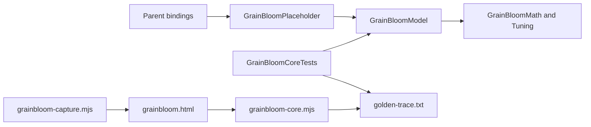
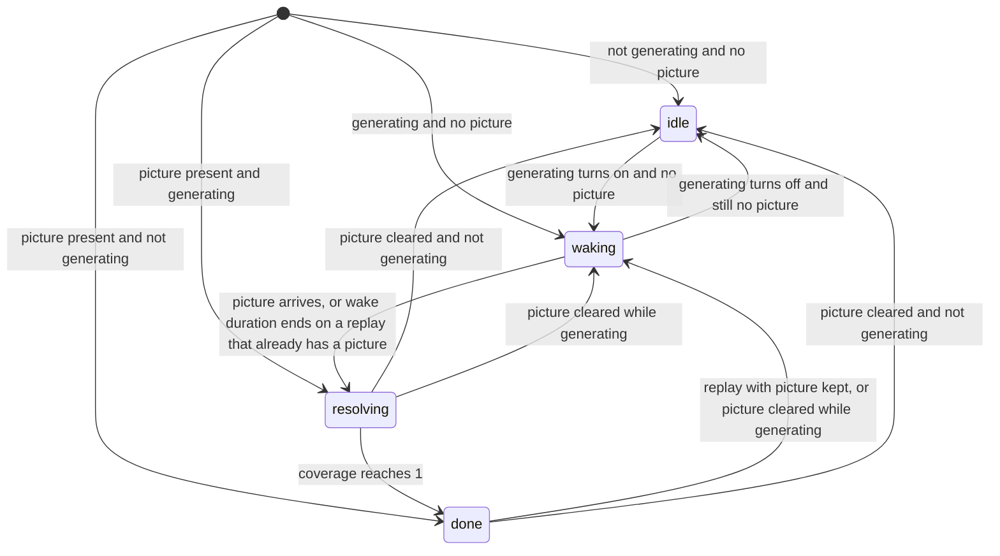

# Grain Bloom Placeholder - Plan

## Goal Capsule

- **Objective:** A person waiting on a generated picture sees the gallery's forty-sixth card sit in grain, wake, and resolve into that picture, and can play the bloom again once it is ready.
- **Means:** A pure-Swift timeline in `GrainBloomCore`, a SwiftUI card in `GrainBloomPlaceholder`, and an HTML canvas port that shares the same constants (KTD1, KTD3, KTD5).
- **Authority:** Product behavior lives on the R-IDs. Mechanism lives on the KTDs. This capsule adds no extra rule.
- **Execution:** One code change, shipped as an open pull request against `main`.
- **Stop:** Do not merge the pull request. Do not change the behavior of components 1–45. Do not add a network image generator.
- **Finishes:** The implementing agent opens the pull request. A person with Xcode merges after a device check.

---

## Product Contract

### Summary

The gallery gains `GrainBloomPlaceholder`, a card that stands in for an image that is still being generated. Grain and dither dots wake, then the picture resolves through a Bayer stagger. Linux tests, a golden trace, a web canvas port, a GIF, and a stills sheet all show that same timeline.

### Problem Frame

The package already ships forty-five tactile components, and none of them is the wait for a generated image. The request asks for that wait, using the "dot noise wakes, then resolves into the image" idea together with a grainy dithered mesh, and it asks for the same package, gallery, spec, and web-port shape as `OnAirLampToggle`, `GlassDropPourMenu`, and `RotaryDialPasscode`.

### Requirements

**Motion**

- R1. The card moves through idle, waking, resolving, and done.
- R2. Idle shows a slowly drifting mesh of three or four soft color blobs, a film-grain overlay, and a dim ordered-dither dot grid.
- R3. Waking lights the dots in a ripple from the center outward, pulses dot size and brightness, sweeps a shimmer, and shows a subtle "Dreaming…" label.
- R4. When an image arrives, resolving steps the dither cell size through 16 px, 8 px, 4 px, 2 px, and 1 px, drops blur, and reveals the picture cell by cell using a Bayer threshold until the reveal covers the whole card.
- R5. Done plays a brief grain settle and a small success glint, then rests on the image.
- R6. A tap while the card is done replays the bloom. The SwiftUI control takes an optional image, a palette that defaults to the component palette, and a generating flag.

**Accessibility**

- R7. VoiceOver reports "Generating image" until the picture is ready and "Image ready" after that, and offers an accessibility action that replays the bloom.
- R8. Reduce Motion drops the ripple and the drift, and crossfades a static grain gradient into the image.

**Package, web, and proof**

- R9. `GrainBloomCore` is pure Swift. Its phase timeline, Bayer 4×4 and 8×8 matrices, ripple schedule, cell-size steps, seeded grain, and blob drift are deterministic. Swift Testing covers determinism, phase transitions, a resolve whose reveal never goes backwards, reveal coverage that reaches 100%, and the Reduce Motion path.
- R10. The SwiftUI layer compiles only when SwiftUI can be imported. It draws with `Canvas` and `TimelineView`. A Metal shader for dither and grain is used only when that shader is available, and `Canvas` is the fallback.
- R11. The component is registered in `Sources/WhimsyGallery/WhimsyGallery.swift`, `Package.swift`, the README (the count reads "Forty-six", plus a table row and a preview section), and `specs/46-grain-bloom-placeholder.md`, in the same slots the current components use.
- R12. `webports/` contains an HTML canvas port with its own script names, the same constants as the Swift core, and a golden-trace check that the JavaScript port matches the Swift core.
- R13. Headless Chrome renders a preview GIF and a stills contact sheet at iPhone size. Both files are saved under `docs/` and copied to the run's artifacts directory, following the capture used for earlier components.
- R14. `swift test` passes on Linux. The pull request against `main` describes the component and the test count, says that SwiftUI and Metal were only parsed on Linux and still need an Xcode build plus a device check, and is not merged.

### Key Flows

- F1. Happy path
  - **Trigger:** The parent sets generating on with no image, then later supplies an image.
  - **Steps:** Idle, then waking (R3), then resolving when the image arrives (R4), then done (R5).
  - **Outcome:** The card shows the picture and VoiceOver says "Image ready" (R7).
  - **Covered by:** R1, R3, R4, R5, R7
- F2. Replay
  - **Trigger:** The card is done and the person taps it, or activates the accessibility replay action.
  - **Steps:** The bloom runs again with the same picture (R6, R7).
  - **Outcome:** The card returns to done.
  - **Covered by:** R6, R7
- F3. Reduce Motion
  - **Trigger:** Reduce Motion is on before or during the wait.
  - **Steps:** No ripple and no drift. A static grain gradient crossfades to the image (R8).
  - **Outcome:** The picture is fully visible without the dither ladder.
  - **Covered by:** R8

### Acceptance Examples

- AE1. Image arrives during waking
  - **Covers:** R3, R4
  - **Given:** The card is waking and has no picture.
  - **When:** An image arrives.
  - **Then:** Resolving starts, and the reveal runs through the cell-size steps until coverage is complete.
- AE2. Replay from done
  - **Covers:** R6
  - **Given:** The card is done and a picture is showing.
  - **When:** The person taps the card.
  - **Then:** The bloom plays again and the card ends done with that same picture.
- AE3. Reduce Motion crossfade
  - **Covers:** R8
  - **Given:** Reduce Motion is on and no picture is present.
  - **When:** An image arrives.
  - **Then:** Blob positions do not drift, the ripple does not run, and the picture fades in over the static gradient.
- AE4. Full reveal
  - **Covers:** R4, R9
  - **Given:** A resolve is running on a fixed sample lattice.
  - **When:** Resolve progress reaches the end of the 1 px step.
  - **Then:** Every lattice sample is revealed, and coverage never decreased during that resolve.

### Scope Boundaries

- The change adds component 46 and the docs, tests, and web port that the existing components already have.
- No image is fetched or generated over the network. The parent supplies the picture.
- Components 1–45 keep their current behavior.
- The pull request is not merged. An Xcode build and a device pass are called out as remaining work, not done in this change.
- The success glint is drawn. This component does not add a haptic.
- A `tools/46-grain-bloom-placeholder.md` runbook is not required. Components 35 and 45 have one; the spec's verification section is enough here.

#### Deferred to Follow-Up Work

- Capture a `docs/solutions/` note for the gallery and golden-trace conventions once this component has landed.
- Tune durations and palette RGB after the GIF is visible, without changing the phase rules.

### Success Criteria

- `swift test` on Linux is green, including the new `GrainBloomCore` suites.
- The JavaScript parity script reports the golden trace matches.
- `docs/grainbloom.gif` and `docs/grainbloom-stills.png` exist, and the same two files are in the artifacts directory.
- The open pull request names the component, states how many tests ran, and states that SwiftUI and Metal were only parsed on Linux.

---

## Planning Contract

### Key Technical Decisions

- KTD1. **Two targets, same slots as 42–45.** `GrainBloomCore` depends on `WhimsyCore`. `GrainBloomPlaceholder` depends on `GrainBloomCore` and is an empty module when SwiftUI cannot be imported. `Package.swift` exposes both as libraries and adds the view to `WhimsyGallery`'s dependency list. Core files follow `Sources/OnAirCore/` and `Sources/GlassPourCore/`: `Exports.swift` re-exports `WhimsyCore`, `GrainBloomTuning.swift` holds constants, `GrainBloomMath.swift` holds pure functions, `GrainBloomModel.swift` holds the phase machine. The request's optional Metal path was checked against skipping Metal the way components 42–45 do. Those components have no shader, and Linux cannot compile one. The request still asks for a shader behind an availability check, and `Package.swift` already swaps `metalResources` / `metalExclude` so `Resources` is omitted on Linux. The shader stays additive. The Canvas path is the one Linux, the golden trace, and the web port can show.
- KTD2. **The core never sees pixels.** The SwiftUI `Image` stays in the view. The model stores whether a picture is present and an integer epoch. The view maps a nil image to absent and a non-nil image to present. The epoch bumps only when presence changes. `Image` has no stable identity, so a parent that wants a second resolve sets the image to nil and then to the new picture. Reveal math is sampled without a bitmap, so tests and the JavaScript port reach 100% coverage. Putting `Image` in the core would pull SwiftUI into the Linux test target, which this package does not do.
- KTD3. **One reveal rule, shared with JavaScript.** Blob centers are a deterministic function of time and a seed (two sinusoids plus a seeded phase), not a stored random walk. Grain samples come from `SeededRandom` in `Sources/WhimsyCore/`. The 4×4 Bayer matrix is the conventional one below. The 8×8 matrix is the conventional recursive tiling of that 4×4, values 0 through 63. The mask quantizes a 390×844 stage into squares of the current cell size (16, 8, 4, 2, then 1). A square is revealed when resolve progress is at least `(threshold + 0.5) / 64`, using the 8×8 matrix tiled across those squares. A pixel revealed at a coarser size stays revealed when the cell shrinks. A fixed 32×32 lattice samples that same predicate for tests and the golden trace. Coverage is revealed lattice samples divided by lattice count. It is monotonic within an epoch and equals 1 at progress 1. Blur radius, shimmer position, and glint opacity are functions of phase time in tuning: blur is 0 at the end of the 1 px step, shimmer travels from 0 to 1 across the wake, and glint is the settle opacity inside done. Reduce Motion holds shimmer at 0, grain at frame 0, blobs at time zero, and dot size and brightness at their time-zero values. The golden file has a full-motion session and a Reduce Motion session, in the text form used by `Tests/OnAirCoreTests/GoldenTraceTests.swift`, with eight decimal places, and it prints blur, shimmer, and glint. `webports/grainbloom-core.mjs` copies the tuning constants and both matrices.
- KTD4. **Drawing.** The view uses `TimelineView` and `Canvas`, the way `Sources/GlassDropPourMenu/GlassDropPourMenu.swift` does. It reads `@Environment(\.accessibilityReduceMotion)` and forwards it with `setReduceMotion`, the way `OnAirLampToggle` does. The optional Metal shader lives at `Sources/GrainBloomPlaceholder/Resources/GrainBloom.metal` and is sampled only inside an availability check, following `Sources/GrainyRingGallery/`. If the shader is unavailable, Canvas draws the same mask the core computed.
- KTD5. **Web port names.** `webports/grainbloom.html`, `webports/grainbloom-core.mjs`, `webports/grainbloom-parity.mjs`, and `webports/grainbloom-capture.mjs`. The page exposes the same hooks the existing capture scripts use (`renderAt`, `renderSheet`, a ready flag, iPhone-sized stage). The parity script compares its trace to `Tests/GrainBloomCoreTests/Fixtures/golden-trace.txt`.

### High-Level Technical Design

The view owns SwiftUI types and input. The model owns phase and time. Math owns Bayer, ripple delays, cell size, grain, and blob positions. Tests and the JavaScript port both drive the model (or its port) and compare numbers, not pixels.



Phase edges the model must implement. Product meaning is R1–R8. The edges that the request did not spell out are the Assumptions, and the model follows those.



Conventional Bayer 4×4, copied into Swift tuning and the JavaScript port. Index is the threshold, not a normalized fraction. KTD3 owns how progress compares to it.

| 0 | 8 | 2 | 10 |
| --- | --- | --- | --- |
| 12 | 4 | 14 | 6 |
| 3 | 11 | 1 | 9 |
| 15 | 7 | 13 | 5 |

### Assumptions

These are unvalidated bets. The request did not choose them. Implementation follows them unless a later instruction overrides one.

- The first sync uses the current flags. Generating on and no picture enters waking immediately, with no idle hold. Generating on and a picture present enters resolving. Generating off and a picture present enters done at phase time 0, with the settle clock idle and no glint. A later rising edge of generating, with no picture, also enters waking.
- Resolve starts when a picture becomes present, including when the generating flag is already false. An arrival during waking interrupts waking and starts resolving.
- Generating turning off before a picture exists eases waking back to idle. It does not play resolving.
- Generating turning on again after done does not replay and does not hide the picture. Replay is the tap and the accessibility action, and only while done with a picture present. Replay keeps the picture, stays in waking until the wake duration elapses, then enters resolving, then done. The settle and the glint play inside done after coverage reaches 1, not while resolving.
- A new picture is a falling edge to absent, then a rising edge to present. That is how a second generation restarts the wait. Replacing the SwiftUI image value without passing through nil does not bump the epoch, because `Image` has no stable identity. Coverage is monotonic only inside one epoch.
- Clearing the picture returns to idle, or to waking if generating is still on.
- A tap outside done does nothing. The accessibility replay action is exposed only while done.
- Reduce Motion uses a crossfade of about 0.28 seconds, the short duration already used by sibling components. Dot size, brightness, shimmer, grain frame, and blob centers stay at their time-zero values. Turning Reduce Motion on mid-flight switches to that crossfade and does not move coverage backwards. Turning it off does not invent a ripple for the current run. The next replay or the next generating edge may use full motion.
- An empty palette uses the default four colors in tuning. More than four colors keep the first four. Non-finite channels are replaced by the default slot. A palette change crossfades color and does not reset the phase.
- "Dreaming…" is drawn during waking only, and is hidden from VoiceOver. The spoken value stays on R7.
- The success glint is opacity and a short grain settle. No haptic.
- The public view stays the optional image, the palette, and the generating flag from R6. It does not add an identity integer.
- Exact default RGB values, wake duration, resolve duration, and settle duration are chosen in `GrainBloomTuning` during implementation and then frozen by the golden trace. Tests read those constants. A duration change regenerates the fixture. It does not change the phase graph.
- The web demo draws a procedural stand-in picture. The SwiftUI demo draws a SwiftUI shape or symbol. Neither path feeds pixels into the core.

### Sequencing

U1 builds the phase machine. U2 adds the math the machine samples. U3 freezes the trace and the JavaScript port. U4 is the SwiftUI card and gallery registration. U5 is the README, spec, HTML page, and capture. Gallery registration can start from U1. The card's drawing waits until U2. U5 waits until U3's core module and golden fixture and U4's gallery copy are both real. U5's HTML page implements `renderAt`, `renderSheet`, and the ready flag.

---

## Output Structure

```text
Sources/GrainBloomCore/
  Exports.swift
  GrainBloomTuning.swift
  GrainBloomMath.swift
  GrainBloomModel.swift
Sources/GrainBloomPlaceholder/
  GrainBloomPlaceholder.swift
  Resources/GrainBloom.metal
Tests/GrainBloomCoreTests/
  ModelTests.swift
  MathTests.swift
  GoldenTraceTests.swift
  Fixtures/golden-trace.txt
webports/
  grainbloom.html
  grainbloom-core.mjs
  grainbloom-parity.mjs
  grainbloom-capture.mjs
specs/46-grain-bloom-placeholder.md
docs/grainbloom.gif
docs/grainbloom-stills.png
```

`Package.swift`, `Sources/WhimsyGallery/WhimsyGallery.swift`, and `README.md` are edited in place.

---

## Implementation Units

### U1. Phase machine

- **Goal:** `GrainBloomModel` steps idle, waking, resolving, and done, including the Assumption edges, and tests lock that graph.
- **Requirements:** R1, R5, R6, R8, R9
- **Dependencies:** None
- **Files:**
  - `Sources/GrainBloomCore/Exports.swift`
  - `Sources/GrainBloomCore/GrainBloomTuning.swift`
  - `Sources/GrainBloomCore/GrainBloomModel.swift`
  - `Tests/GrainBloomCoreTests/ModelTests.swift`
  - `Package.swift`
- **Approach:**
  - Add the core target and its test target in `Package.swift`. Leave the view target and the gallery dependency to U4.
  - The model accepts generating, picture presence, palette samples, Reduce Motion, replay, and `step` with a time delta. It exposes phase, phase time, resolve progress, cell size, reveal coverage, blur, shimmer, glint, and the VoiceOver value string from R7.
  - Replay from done restarts at waking with the picture kept, stays there until the wake duration elapses, then enters resolving. Replay from any other phase is ignored.
  - The first sync follows the Assumptions: generating with no picture is waking, both present is resolving, picture without generating is done at phase time 0 with the settle clock idle.
  - Done begins when coverage reaches 1. The settle and the glint run inside done.
  - Reduce Motion skips drift, the cell-size ladder, the dot pulse, and the shimmer, and advances a crossfade instead.
- **Patterns to follow:** `Sources/GlassPourCore/GlassPourModel.swift`, `Sources/OnAirCore/OnAirModel.swift`, `Sources/RippleToHideCore/RippleModel.swift`
- **Test scenarios:**
  - Starting idle, turning generating on with no picture, then stepping, yields waking.
  - From waking, picture presence turning on yields resolving before the wake duration ends.
  - Stepping resolving until progress is 1 yields done, and coverage at the end is 1.
  - From done, replay yields waking and the picture stays present. Stepping for less than the wake duration stays in waking. Stepping through the wake duration enters resolving. After another full step-through, phase is done again.
  - Replay during waking or resolving leaves the phase unchanged.
  - Generating turning off during waking, with no picture, returns to idle.
  - First sync with a picture present and generating false yields done at phase time 0 and does not start the settle clock.
  - First sync with generating true and no picture yields waking.
  - First sync with generating true and a picture present yields resolving.
  - Generating turning on after done, without replay and without a presence change, stays done.
  - An epoch bump during done yields resolving.
  - Clearing the picture during done while generating is on yields waking. Clearing it while generating is off yields idle.
  - Two models with the same seed and the same events, stepped with the same deltas, report the same phase, progress, and coverage.
  - With Reduce Motion on, an image arrival moves a crossfade from 0 to 1, does not enter the cell-size ladder, and keeps dot size and brightness at their time-zero values.
  - Turning Reduce Motion on during resolving does not reduce coverage.
- **Verification:** The model tests pass, and the core target builds on Linux without SwiftUI types.

### U2. Dither, ripple, grain, and mesh

- **Goal:** Pure functions implement KTD3 and the idle and waking look from R2 and R3, with tests that do not depend on the view.
- **Requirements:** R2, R3, R4, R9
- **Dependencies:** U1
- **Files:**
  - `Sources/GrainBloomCore/GrainBloomMath.swift`
  - `Sources/GrainBloomCore/GrainBloomTuning.swift`
  - `Tests/GrainBloomCoreTests/MathTests.swift`
- **Approach:**
  - Put the 4×4 table and the derived 8×8 table in tuning, next to the lattice size and the five cell sizes.
  - Ripple delay at a point is proportional to its distance from the card center, normalized by the card diagonal. Dot size and brightness are functions of that delay and wake time.
  - Cell size is 16, 8, 4, 2, then 1 across equal slices of resolve progress. The mask uses squares of that size on a 390×844 stage, per KTD3. The 32×32 lattice samples that predicate.
  - Grain is a deterministic sample from `SeededRandom` at a grain-frame index. Reduce Motion freezes the frame index.
  - Blob centers use the sinusoid rule in KTD3. Reduce Motion returns the centers at time zero.
  - Blur radius, shimmer position, and glint opacity are the tuning functions in KTD3.
- **Patterns to follow:** `Sources/WhimsyCore/` `SeededRandom` and `WhimsyMath`, `Sources/RingGalleryCore/RingGalleryModel.swift` for a frozen grain clock
- **Test scenarios:**
  - The 4×4 table matches the High-Level Technical Design matrix, and the 8×8 table's values are exactly the set 0 through 63 with no duplicates.
  - The same seed and coordinates return the same grain sample on two calls. A different seed changes the sample.
  - At resolve progress 0, coverage is below 1. At progress 1, coverage is 1. Samples taken at increasing progress never report a lower coverage inside one epoch.
  - A lattice point with a low Bayer threshold is revealed at a smaller progress than a point with a high threshold.
  - Cell size is 16 in the first slice and 1 in the last slice, and the sequence never increases inside one resolve.
  - Ripple delay at the center is 0, and delay at a corner is greater than delay at an edge midpoint.
  - Blob centers at time 0 and at a later time differ when Reduce Motion is off, and they stay at the time-zero positions when Reduce Motion is on.
  - Shimmer position is 0 at the start of waking and 1 at the end, and it stays 0 when Reduce Motion is on.
  - Blur radius is 0 at the end of the 1 px step. Glint opacity is 0 before done and rises only during the settle inside done.
  - A pixel revealed at cell size 16 stays revealed at cell size 1 in the same epoch.
  - An empty palette input resolves to four default colors. A five-color input keeps the first four.
- **Verification:** Math tests pass on Linux and do not import SwiftUI.

### U3. Golden trace and JavaScript port

- **Goal:** A checked-in trace from the Swift core matches `grainbloom-core.mjs` on the same script, for full motion and Reduce Motion.
- **Requirements:** R9, R12
- **Dependencies:** U1, U2
- **Files:**
  - `Tests/GrainBloomCoreTests/GoldenTraceTests.swift`
  - `Tests/GrainBloomCoreTests/Fixtures/golden-trace.txt`
  - `webports/grainbloom-core.mjs`
  - `webports/grainbloom-parity.mjs`
  - `Package.swift`
- **Approach:**
  - The trace header prints the tuning constants and the first row of each Bayer matrix. The body scripts: wake then image arrival then settle; cancel generating during waking; epoch bump during resolving; replay from done; the same script with Reduce Motion.
  - Snapshot lines use a fixed field order and eight decimal places, half away from zero, matching `Tests/OnAirCoreTests/GoldenTraceTests.swift`. The order includes blur, shimmer, and glint.
  - Exclude `Fixtures` on the test target, the way `OnAirCoreTests` does.
  - The parity script reads the fixture and fails with a line diff when the JavaScript trace differs.
- **Execution note:** Generate the fixture from the Swift core, then make the JavaScript port match it. Do not hand-edit the two traces to agree.
- **Patterns to follow:** `Tests/OnAirCoreTests/GoldenTraceTests.swift`, `webports/onair-core.mjs`, `webports/onair-parity.mjs`, `webports/rotarydial-core.mjs`
- **Test scenarios:**
  - The Swift trace function equals the checked-in fixture.
  - The JavaScript trace equals that same fixture, including the Reduce Motion session.
  - A one-value perturbation of a printed constant makes the parity check fail.
  - Full-motion coverage samples in the trace are monotonic within each epoch and end at 1.
  - The Reduce Motion session's blob coordinates stay at the time-zero values.
- **Verification:** The golden Swift test passes, and the parity script exits 0.

### U4. SwiftUI card and gallery entry

- **Goal:** The gallery lists Grain Bloom and shows a demo that runs F1 and F2. The control matches R6, R7, R8, and R10.
- **Requirements:** R6, R7, R8, R10, R11
- **Dependencies:** U1, U2
- **Files:**
  - `Sources/GrainBloomPlaceholder/GrainBloomPlaceholder.swift`
  - `Sources/GrainBloomPlaceholder/Resources/GrainBloom.metal`
  - `Sources/WhimsyGallery/WhimsyGallery.swift`
  - `Package.swift`
- **Approach:**
  - Wrap the view file in the SwiftUI import check used by `Sources/OnAirLampToggle/OnAirLampToggle.swift`.
  - The control takes the image, the palette, and the generating flag from R6. The demo owns those values, supplies a stand-in picture by setting it after a nil, and can replay.
  - Canvas draws blobs, grain, the dither mask, the shimmer, the "Dreaming…" label, and the glint from model fields. The picture is a view-layer composite under the mask.
  - The Metal file is processed only on the Apple side of the `metalResources` switch. Canvas remains compiled in the same file as the fallback.
  - Gallery: import, a new `GalleryItem` case at the end of the list, and arms for title, subtitle, symbol, and demo. Title "Grain Bloom". Doc comment and any "forty-five" count in that file become forty-six.
  - Accessibility: one element, the value from the model, the replay action only in done, decorative canvas hidden from VoiceOver.
- **Patterns to follow:** `Sources/OnAirLampToggle/OnAirLampToggle.swift`, `Sources/GlassDropPourMenu/GlassDropPourMenu.swift`, `Sources/WhimsyGallery/WhimsyGallery.swift`, `Sources/GrainyRingGallery/`
- **Test scenarios:**
  - Test expectation: none for behavior on Linux. The view target is empty there, so phase behavior stays in U1 and U2.
  - Integration check on Linux: `swiftc -parse` accepts the view file and the gallery file.
  - The gallery source contains the new case and no longer describes the gallery as forty-five components.
- **Verification:** The package builds on Linux, the two parse checks succeed, and the gallery enum lists the new case last.

### U5. Spec, README, page, and capture

- **Goal:** Docs and the web page show component 46 the way 45 is shown, including a GIF and a stills sheet.
- **Requirements:** R11, R12, R13, R14
- **Dependencies:** U3, U4
- **Files:**
  - `README.md`
  - `specs/46-grain-bloom-placeholder.md`
  - `webports/grainbloom.html`
  - `webports/grainbloom-capture.mjs`
  - `docs/grainbloom.gif`
  - `docs/grainbloom-stills.png`
- **Approach:**
  - README: opening count "Forty-six", summary table row after RotaryDialPasscode, product-list sentence, gallery blurb, layout tree, accessibility table row for the Reduce Motion crossfade, and a component section with the GIF, the import, the demo name, and the Linux parse limitation.
  - The spec uses the heading shape of `specs/45-rotary-dial-passcode.md`: API, constants, behaviour, accessibility, verification. Constants point at the tuning type and the JavaScript port.
  - The HTML page is a 390×844 stage, imports the core module, and implements the capture hooks from KTD5. It plays F1, then a replay, and can draw a stills strip.
  - The capture script follows `webports/rotarydial-capture.mjs`: puppeteer-core, an ephemeral static server, screenshots of the stage, ffmpeg for the GIF, a sheet screenshot, writes under `docs/`, and copies both images to the artifacts directory.
- **Patterns to follow:** `README.md` RotaryDial section, `specs/45-rotary-dial-passcode.md`, `webports/rotarydial.html`, `webports/rotarydial-capture.mjs`
- **Test scenarios:**
  - The HTML module loads and `renderAt` at time 0 and at the end of the demo does not throw.
  - The stills sheet includes an idle frame, a waking frame, a resolving frame, and a done frame.
  - README no longer says the package has forty-five components, and it links the new GIF.
  - The spec states the VoiceOver strings from R7 and the Reduce Motion rule from R8.
- **Verification:** The GIF and the stills file exist under `docs/` and in the artifacts directory. The page plays the demo in headless Chrome at iPhone size.

---

## Verification Contract

| Check | Command | Applies to |
| --- | --- | --- |
| Package tests | `swift test` from the repo root | U1–U5, R9, R14 |
| Core suites only | `swift test --filter GrainBloomCoreTests` | U1–U3 |
| Trace parity | `node webports/grainbloom-parity.mjs` | U3, R12 |
| SwiftUI parse | `swiftc -parse Sources/GrainBloomPlaceholder/GrainBloomPlaceholder.swift` and `swiftc -parse Sources/WhimsyGallery/WhimsyGallery.swift` | U4, R10 |
| Capture | `node webports/grainbloom-capture.mjs` with Chrome available | U5, R13 |

`swift test` does not run the parity script or the capture. Those stay separate, as they are for components 42–45. The pull request body records the `swift test` count and the Xcode gap from R14.

---

## Definition of Done

- U1–U5 are present, and no unused experiment files remain in the diff.
- `swift test` passes on Linux.
- `node webports/grainbloom-parity.mjs` exits 0.
- `docs/grainbloom.gif` and `docs/grainbloom-stills.png` are in the commit, and copies are in the artifacts directory.
- README count, gallery case, spec, and package products all name component 46.
- The pull request is open against `main`, unmerged, and its body covers R14.

---

## Risks and Dependencies

- Linux builds an empty view module. A SwiftUI or Metal type error can survive `swift test`. The parse checks and the pull-request note are the mitigation, not a substitute for Xcode.
- Capture needs `puppeteer-core`, ffmpeg, and a Chrome binary, the same stack as `webports/rotarydial-capture.mjs`. If Chrome is missing, the GIF cannot be produced in this environment and the unit is not done.
- Golden-trace floats drift if Swift and JavaScript round differently. Both sides use the eight-decimal, half-away-from-zero format from the OnAir trace.
- `Image` is not a stable identity. A second picture restarts resolving only after the image passes through nil. A parent that swaps the bitmap in place will not see a new resolve.

---

## Sources and Research

- `Package.swift` `metalResources` / `metalExclude` switch, and the product list through `RotaryDialPasscode`.
- `README.md` count line "Forty-five", the RotaryDial table row, the accessibility table, and the layout tree.
- `Sources/OnAirCore/`, `Sources/GlassPourCore/`, `Sources/RotaryDialCore/` for the core split and Reduce Motion flag.
- `Sources/WhimsyGallery/WhimsyGallery.swift` for the five parallel switches on `GalleryItem`.
- `Tests/OnAirCoreTests/GoldenTraceTests.swift` and `webports/onair-parity.mjs` for the trace format.
- `webports/rotarydial-capture.mjs` for GIF and stills output paths.
- `Sources/GrainyRingGallery/` for a Metal grain effect with a Canvas-side description.
- `docs/solutions/` is absent. No prior learning note covers this gallery.
- External pages named in the request (transitions.dev, grainient.supply) were treated as the inspiration the request already summarized. Local component patterns were enough to choose the package shape, so those sites were not fetched.
